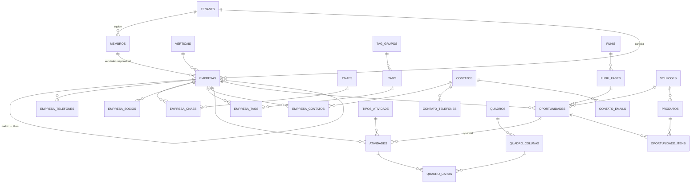

# CRM Alessandro — Modelagem do Banco de Dados

> Status: **Aprovado (v1.1)** · Data: 06/10/2026
> v1.1: revisão pelo protótipo: `membros.preferencias`; próxima atividade calculada em `empresas`; datas de controle de parada em `oportunidades`
> v1.0: modelagem fechada (consolida v0.1 a v0.3)
> v0.2: incluído o **complemento** do endereço na tabela `empresas`
> v0.3: **multiempresa**: conta dona de várias empresas (tenants), usuários com papel por empresa e painel consolidado
> Base: `configuracao_tecnologia.md` (v1.3) e `funcionalidades.md` (v1.4)
> Banco: PostgreSQL + PostGIS · Nomes em **português**, `snake_case`

---

## 0. Decisões desta etapa

| # | Decisão | Escolha |
|---|---|---|
| 1 | Vendedores | **Vendedor = membro da equipe (usuário)**. Pode existir sem login (ex.: representante externo) |
| 2 | Atividades × Tarefas | **Unificadas** numa única tabela `atividades` (tipo "Tarefa" incluído) |
| 3 | Oportunidade | **Status separado da Fase**: Ativo · Conquistado · Perdido · Cancelado · Suspenso |
| 4 | Solução | Tabela cadastrável `solucoes` (agrupa produtos) |
| 5 | Recorrência de produtos | Item com cobrança **Única / Mensal / Anual** + meses → Valor único, Valor mensal (MRR) e Valor total |
| 6 | Documento da empresa | **CNPJ, CPF ou sem documento**; CNPJ único por tenant |
| 7 | Matriz/filial | Vínculo automático pela **raiz do CNPJ** |
| 8 | Data de registro | Data de cadastro no CRM (`criado_em`) |
| 9 | Campos extras da Receita | Apenas o **complemento** do endereço (v0.2); os demais ficam só no JSON do cache de consultas |
| 10 | Atualização Receita | Botão "Atualizar pela Receita" (com comparação) + rotina mensal de verificação |
| 11 | Funcionários / Faturamento | **Faixas cadastráveis** (+ nº exato opcional de funcionários) |
| 12 | Prospecção | **Sim**: busca por CNAE + UF/município na API e importação como Lead |
| 13 | Vertical | **Uma por empresa**; substitui o grupo de tags "Segmento" |
| 14 | Situação da atividade | Pendente · Em execução · Realizada · **Cancelada** (Atrasada é calculada) |
| 15 | Contatos (extras) | Papel na decisão, aniversário, LinkedIn, consentimento LGPD |
| 16 | Multiempresa | **Conta dona** de várias empresas (tenants); dados **isolados** por empresa + **painel consolidado**; cópia de configurações entre empresas |
| 17 | Usuários em várias empresas | Mesmo login em várias empresas, com **papel definido em cada uma** |

---

## 1. Convenções

| Item | Padrão |
|---|---|
| Chave primária | `id uuid` (UUID v7, gerado na aplicação) |
| Multitenant | `tenant_id uuid NOT NULL` em toda tabela de negócio + **RLS** |
| Auditoria básica | `criado_em`, `atualizado_em` (`timestamptz`), `criado_por`, `atualizado_por` (→ `membros`) |
| Exclusão | **Soft delete**: `excluido_em timestamptz` (lixeira) |
| Datas e horas | `timestamptz` (gravado em UTC; exibido no fuso do tenant) |
| Dinheiro | `numeric(15,2)` (nunca `float`) |
| Textos de busca | `citext` para e-mails; índices `pg_trgm` + `unaccent` em nomes |
| Enumerações fixas | Tipos `ENUM` do Postgres (ex.: `situacao_atividade`) |
| Listas que o cliente edita | Tabelas cadastráveis (ex.: `origens`, `motivos`) |
| Campos personalizados | Coluna `campos_extras jsonb` (definições em `campos_personalizados`) |
| Unicidade com soft delete | Índices únicos **parciais** (`WHERE excluido_em IS NULL`) |
| Ordenação manual (Kanban) | Coluna `posicao` com índice fracionário (texto), sem renumerar a lista |

**Legenda das tabelas:**
🌐 global (sem tenant, compartilhada, somente leitura para a aplicação) · 🏢 por tenant (com RLS) · 🔮 fase futura

---

## 2. Visão geral (diagrama)



---

## 3. Plataforma e tenant

### 3.0 Estrutura multiempresa

```
CONTA (dono / grupo)  ── cobrança, criação de empresas, administradores da conta
  ├── EMPRESA A (tenant) ── carteira, equipe, funis, tags… (isolados por RLS)
  ├── EMPRESA B (tenant)
  └── EMPRESA C (tenant)

USUÁRIO (login único) ── MEMBRO na Empresa A (admin)
                      └─ MEMBRO na Empresa B (vendedor)
```

- **Isolamento total** de dados entre empresas. O que muda é o **acesso**: um login pode ter vínculo (membro) em várias empresas, com papel próprio em cada uma.
- **Seletor de empresa** no topo do app. A sessão guarda a **empresa ativa** (`auth.session.empresa_ativa_id`), e toda requisição roda com `app.tenant_id` = empresa ativa.
- **Painel consolidado** (somente leitura): para **administradores da conta** (`conta_administradores`, papel dono ou administrador), a requisição define `app.tenant_ids` = todas as empresas da conta, e as políticas RLS de **leitura** aceitam `tenant_id = ANY(app.tenant_ids)`. Gravações continuam exigindo uma única empresa ativa.
- **Copiar configurações** entre empresas da mesma conta: funis/fases, grupos de tags/tags, tipos de atividade, origens, motivos, soluções, produtos, faixas, verticais, campos personalizados e quadro modelo. É uma cópia (não um vínculo): depois cada empresa ajusta a sua.
- **Notificações** de todas as empresas aparecem na central, identificadas pela empresa (clicar troca a empresa ativa).

> **Descoberta de vínculos antes do tenant ativo (E8):** o guard da API precisa saber em quais empresas o usuário é membro *antes* de definir `app.tenant_id`, mas `membros` e `tenants` têm RLS forçado, que vale **também para o dono**. Sem papel `BYPASSRLS` e sem afrouxar o RLS do app, duas funções `SECURITY DEFINER` mínimas (do `leadtogo_owner`, `search_path` fixo, `EXECUTE` só para o `leadtogo_app`):
> - `app_vinculos_do_usuario(usuario_id)` → `(tenant_id, papel)` dos membros **ativos e não excluídos** do usuário. Só isso: o resto do membro se lê depois, com o tenant ativo, sob RLS.
> - `app_empresas_da_conta_do_usuario(usuario_id)` → `tenant_id` das empresas **em teste ou ativas** das contas em que o usuário é `dono` ou `administrador` (o `financeiro` não entra): é o `app.tenant_ids` do painel consolidado.
>
> - `app_vinculos_com_politica(usuario_id)` (migração 0011) → `(tenant_id, papel, dois_fatores_exigido)` dos mesmos vínculos, com a política de 2FA de cada empresa (`admin` se a empresa ainda não tem linha em `tenant_configuracoes`). É a que o guard da API usa; a `app_vinculos_do_usuario` fica até a contração (remover quando nada mais a usar). Política extra `FOR SELECT TO leadtogo_owner` em `tenant_configuracoes`, casada com a mesma variável `app.vinculos_usuario` e só para as empresas em que o usuário é membro ativo.
>
> Cada função define uma variável de transação (`app.vinculos_usuario` / `app.consolidado_usuario`) e a limpa ao terminar. Uma política `FOR SELECT TO leadtogo_owner` em `membros` e outra em `tenants` só casa com essa variável; como valem só para o papel `leadtogo_owner` (o app não é o owner, e o owner fora das funções não define a variável), nada muda para o app, para o owner direto nem para o isolamento entre empresas. Migração 0006.

### 3.0.1 `contas` 🌐 — Conta dona (cobrança e gestão)
| Coluna | Tipo | Observação |
|---|---|---|
| id | uuid PK | |
| nome | text NOT NULL | Ex.: "Grupo Alessandro" |
| documento | varchar(14) | CNPJ/CPF para faturamento |
| email_cobranca | citext | |
| plano | text | Plano contratado (limites de empresas/usuários) |
| situacao | enum | teste · ativa · suspensa · cancelada |
| criado_em, atualizado_em | timestamptz | |

### 3.0.2 `conta_administradores` 🌐
| Coluna | Tipo | Observação |
|---|---|---|
| conta_id | uuid FK | PK `(conta_id, usuario_id)` |
| usuario_id | uuid FK → `auth.user` | |
| papel | enum(dono/administrador/financeiro) | **Dono:** tudo, incluindo excluir a conta e transferir a posse · **Administrador:** cria empresas e tem acesso de admin em todas · **Financeiro:** só cobrança |
| criado_em | timestamptz | |

> Administradores da conta passam a ser **membros admin** de cada nova empresa automaticamente.
> Essas duas tabelas não têm RLS por tenant; o acesso é controlado pela API (somente usuários da própria conta).

### 3.1 `tenants` 🏢 — Cadastro da empresa que usa o sistema
Pode ser preenchido pela mesma consulta à Minha Receita.

| Coluna | Tipo | Observação |
|---|---|---|
| id | uuid PK | |
| razao_social | text NOT NULL | |
| nome_fantasia | text | |
| cnpj | varchar(14) | Alfanumérico (ver seção 12). **Sem unicidade global** (migração 0014): a restrição revelava a quem cadastra que outra conta usa o CNPJ. Índice `(conta_id, cnpj)` para avisar sobre repetição dentro da mesma conta |
| email, telefone, website | text | Contato institucional |
| cep, tipo_logradouro, logradouro, numero, complemento, bairro | text | |
| municipio_codigo | int FK → `municipios` | Cidade + UF |
| pais_codigo | smallint default 105 | Código do país na Receita (105 = Brasil) |
| logo_arquivo_id | uuid FK → `arquivos` | |
| conta_id | uuid FK → `contas` NOT NULL | Conta dona |
| situacao | enum `situacao_tenant` | teste · ativo · suspenso · cancelado |
| plano | text | Para cobrança futura (SaaS) |
| fuso_horario | text default 'America/Sao_Paulo' | |
| moeda | char(3) default 'BRL' | |
| criado_em, atualizado_em | timestamptz | |

### 3.2 `tenant_configuracoes` 🏢 (1:1 com tenant)
| Coluna | Tipo | Observação |
|---|---|---|
| tenant_id | uuid PK/FK | |
| vendedor_ve_todas_empresas | boolean default false | Regra de carteira |
| dias_sem_contato_alerta | int default 60 | Dashboard / filtros |
| dias_validade_tag_visita | int null | null = não expira |
| bloquear_empresa_nao_ativa | boolean default true | Não cadastra CNPJ que não esteja ativo na Receita (só cadastro novo); migração 0017 |
| status_cliente_ao_conquistar | boolean default true | Ao conquistar, muda tag Status → Cliente |
| rastreio_email_padrao | boolean default false | 🔮 |
| whatsapp_modo_importacao | enum | 🔮 automático · manual · desligado |
| checkin_modo | enum `modo_checkin` NOT NULL default `avisar` | `avisar` · `bloquear` · `so_gravar` (G3a, migração 0028) |
| checkin_limite_m | int NOT NULL default 300 | Distância máxima do check-in, em metros (CHECK 10 a 50.000) |
| lembrete_relatorios_hora | time NOT NULL default 17:30 | Hora (no fuso da empresa) do lembrete dos relatórios de visita pendentes |
| visitas_padroes_criados_em | timestamptz null | Marca do modelo padrão e dos seis resultados de visita (backfill na partida, `app_tenants_sem_padroes_visita()`) |
| dois_fatores_exigido | enum `politica_dois_fatores` NOT NULL default `admin` | Quem é obrigado a ter 2FA nesta empresa: `admin` · `admin_gestor` · `todos` (migração 0011, de expansão; ver funcionalidades.md, "Segurança e acesso") |
| padroes_criados_em | timestamptz null | Quando os cadastros padrão (seção 5) foram criados. **Preenchido, nunca mais se recria**: um padrão que o administrador excluiu não volta (migração 0016, de expansão) |
| preferencias | jsonb | Demais ajustes |

> **Cadastros padrão por empresa (Módulo 1):** `criarPadroesDoTenant` (`packages/db/src/padroes.ts`) reserva a marca `padroes_criados_em` e cria tags (Status e Visitação), tipos de atividade, funil "Vendas" com 4 fases (alerta de parada de 14 dias), origens e motivos. Roda no primeiro acesso, ao criar empresa do grupo e no seed de demonstração. **Backfill:** a cada start da API (`iniciar.js`, depois do migrate e do seed de referências, com a credencial do dono) o passo `criarPadroesPendentesPorUrl` atende as empresas ainda sem a marca. Como o RLS forçado impede o dono de listar `tenants`, a migração 0016 criou `app_tenants_sem_padroes()` (`SECURITY DEFINER`, política só para o `leadtogo_owner`, travada numa variável que só a função define; devolve apenas ids, sem `EXECUTE` para o `leadtogo_app`). Falha numa empresa não derruba a API: fica o aviso no log e o próximo start tenta de novo.

### 3.3 Autenticação (Better Auth)
O Better Auth cuida só da **identidade**: `user`, `session`, `account`, `verification` e `two_factor`, num **schema separado `auth`**. O **plugin de organizações não é usado** (empresas, membros e convites são nossos, sob RLS). Ligações:
- `user.id` ↔ `membros.usuario_id` e `conta_administradores.usuario_id` (FK)
- `session.empresa_ativa_id` → `tenants.id` (`ON DELETE SET NULL`): a empresa ativa da sessão (campo nosso, adicionado à tabela do Better Auth). Ao criar a sessão a API a preenche (gancho `databaseHooks.session.create`): `user.ultima_empresa_id` se ainda utilizável, senão a única empresa utilizável, senão nulo
- `user.ultima_empresa_id` → `tenants.id` (`ON DELETE SET NULL`, migração 0012): a última empresa que a pessoa usou; gravada a cada troca de empresa ativa
- Tabelas em `auth`: `user` (e-mail em `citext`, único), `session`, `account` (senha em hash scrypt), `verification` e `two_factor`, todas com id `uuid` v7. Sem RLS (nada é por tenant); o `leadtogo_app` tem DML, sem DDL.

### 3.4A `perfis_acesso` e `perfil_permissoes` 🏢 — Perfis de acesso (Fase 1, migração 0027; ✅ aprovada em 23/10/2026)

| `perfis_acesso` | Tipo | Observação |
|---|---|---|
| id, tenant_id | uuid v7 | |
| nome, descricao | text | Único `(tenant_id, nome)` entre não excluídos |
| sistema | boolean | Perfis de sistema não se excluem |
| chave_sistema | text null | `admin` \| `gestor` \| `vendedor`, ou nulo (perfil da empresa). Sempre usada no lugar do nome |
| exige_2fa | boolean | Substitui a política `dois_fatores_exigido` por papel |
| ativo | boolean | |
| colunas padrão | | `criado_em`, `atualizado_em`, `criado_por`, `atualizado_por`, `excluido_em` |

`perfil_permissoes`: `tenant_id`, `perfil_id`, `permissao` (chave do catálogo em `packages/shared/src/permissoes.ts`), `alcance` (nulo \| `propria` \| `equipe` \| `todas`); PK `(perfil_id, permissao)`. As duas tabelas têm RLS habilitado e forçado e teste de isolamento.

`membros.perfil_id` e `convites.perfil_id` entram **nulos** (expandir). O `papel` antigo fica como legado: nenhuma regra nova o lê; perfis da empresa gravam `vendedor` nele só por compatibilidade. `tenant_configuracoes.vendedor_ve_todas_empresas` e `tenant_configuracoes.dois_fatores_exigido` ficam no banco até a contração (a função `app_vinculos_com_politica` ganha uma versão nova que devolve `perfil_id` e `exige_2fa`, em migração de expansão) (fora da Fase 1). O backfill é idempotente, feito na partida da API (depois do migrate): cria os três perfis de sistema por empresa, converte o interruptor e a política de 2FA e liga membros e convites.

> **Implementação (migração 0027, só expansão):** enums `alcance_permissao` e `chave_perfil_sistema`; CHECK `sistema = (chave_sistema IS NOT NULL)`; únicos `(tenant_id, lower(nome))` e `(tenant_id, chave_sistema)` entre os não excluídos; índice `(tenant_id, perfil_id)` em `membros`. Marca `tenant_configuracoes.perfis_criados_em` e a função `app_tenants_sem_perfis()` (só o `leadtogo_owner`, mesmo padrão da 0026) para o backfill na partida. `app_vinculos_com_perfil(usuario_id)` → `(tenant_id, papel, dois_fatores_exigido, perfil_id, perfil_exige_2fa)`: a versão nova da `app_vinculos_com_politica` (que fica até a contração), com política de leitura do owner em `perfis_acesso` presa à variável `app.vinculos_usuario`; ignora perfil excluído ou de outra empresa.

### 3.5 `convites` 🏢 — Convite de membro
| Coluna | Tipo | Observação |
|---|---|---|
| id | uuid PK | |
| tenant_id | uuid FK | |
| email | citext NOT NULL | Para quem foi enviado |
| papel | enum `papel_membro` | Papel que o convidado terá |
| token_hash | text NOT NULL UNIQUE | Hash (SHA-256) do token enviado por e-mail; o token em si **nunca** é gravado |
| expira_em | timestamptz | Validade de 7 dias |
| aceito_em | timestamptz null | Uso único |
| revogado_em | timestamptz null | Cancelado por um administrador antes de ser aceito |
| convidado_por | uuid FK → `membros` NOT NULL | |
| criado_em, atualizado_em | timestamptz | |

Único parcial `(tenant_id, email)` enquanto **pendente** (`aceito_em` e `revogado_em` nulos): reenviar um convite revoga o anterior e cria outro com token novo.

> **Aceite sem sessão (migração 0007):** quem aceita só tem o token, sem tenant ativo, e `convites` tem RLS forçado. Mesmo padrão da descoberta de vínculos (3.0): `app_convite_por_token(hash)`, `SECURITY DEFINER` do `leadtogo_owner`, `search_path` fixo, `EXECUTE` só para o `leadtogo_app`, devolve **só os ids** (`id`, `tenant_id`) e vale por uma política `FOR SELECT TO leadtogo_owner` travada na variável `app.convite_hash`, que só a função define e limpa. O resto (e-mail, papel, validade, situação) a API lê depois, com o tenant ativo e sob RLS.

---|---|---|
| id | uuid PK | |
| tenant_id | uuid FK | |
| email | citext NOT NULL | Para quem foi enviado |
| papel | enum `papel_membro` | Papel que o convidado terá |
| token_hash | text NOT NULL UNIQUE | Hash (SHA-256) do token enviado por e-mail; o token em si nunca é gravado |
| expira_em | timestamptz | Validade de 7 dias |
| aceito_em | timestamptz null | Uso único |
| convidado_por | uuid FK → `membros` | |
| criado_em, atualizado_em | timestamptz | |


### 3.4 `membros` 🏢 — Equipe / **Vendedores**
| Coluna | Tipo | Observação |
|---|---|---|
| id | uuid PK | |
| tenant_id | uuid FK | |
| usuario_id | uuid FK → `auth.user` **null** | null = vendedor **sem acesso** ao sistema |
| nome | text NOT NULL | |
| cargo | text | |
| telefone | varchar(20) | + `telefone_e164` |
| email | citext | |
| papel | enum `papel_membro` | admin · gestor · vendedor |
| gestor_id | uuid FK → `membros` | Hierarquia da equipe |
| cor | char(7) | Cor do vendedor em agenda/mapa |
| foto_arquivo_id | uuid FK | |
| ativo | boolean default true | Inativar mantém o histórico |
| preferencias | jsonb | Preferências de interface (v1.1), com **chaves fechadas**: `tema` (claro/escuro/sistema), `menuRecolhido`, `visaoDashboard` (minha/equipe), `filtroPadrao` (id do filtro salvo por tela: empresas, contatos, oportunidades, tarefas), `porPagina` e `kanbanColapsadas` (por funil, a lista de ids das fases que o usuário recolheu no Kanban; sem migração: é só uma chave nova do JSON). Só se guarda o que foge do padrão; `GET/PATCH /v1/me/preferencias` |
| criado_em, atualizado_em, excluido_em | | |

Únicos: `(tenant_id, email)` parcial; `(tenant_id, usuario_id)`.

O **mesmo usuário** (`usuario_id`) pode ter um registro em `membros` em **cada empresa**, com papel, cargo e gestor próprios naquela empresa (ex.: admin na A, vendedor na B).

> **Implementação (E7):**
> - `membros.usuario_id` e `conta_administradores.usuario_id` são FK para `auth.user` (migração 0005). Apagar um usuário deixa o membro sem login (`ON DELETE SET NULL`), mas é **recusado** se ele ainda administra uma conta (`RESTRICT`). As FKs de `tenants.logo_arquivo_id` e `membros.foto_arquivo_id` para `arquivos` entraram com as tabelas de sistema.
> - `membros` leva também `criado_por` e `atualizado_por` (→ `membros`), pela convenção da seção 1. O único `(tenant_id, usuario_id)` é parcial (`excluido_em IS NULL`), como o de e-mail.
> - `tenants` isola o RLS pela coluna `id` (`aplicar_rls_tenant('tenants', 'id')`). `contas` e `conta_administradores` não têm RLS (acesso controlado pela API); o app tem DML nelas.
> - `tenants.pais_codigo` é `smallint` com padrão `105` (Brasil, código da Receita) e não tem FK para `paises`. `tenant_configuracoes.whatsapp_modo_importacao` é um enum com padrão `desligado`.

---

## 4. Tabelas de referência 🌐 (globais)

| Tabela | Colunas principais | Origem |
|---|---|---|
| `cnaes` | **codigo int PK** (7 dígitos), descricao, secao, divisao, grupo, classe | Carga inicial com a lista oficial IBGE/CONCLA + inclusão automática se a API trouxer um código novo. **PK garante que não há duplicados** |
| `municipios` | **codigo_ibge int PK**, codigo_siafi int UNIQUE, nome, uf, localizacao (centro) | Carga IBGE. A API traz os dois códigos (`codigo_municipio` = SIAFI, `codigo_municipio_ibge`) |
| `estados` | uf char(2) PK, nome, regiao | |
| `paises` | **codigo smallint PK**, nome | Tabela de países da **Receita Federal** (dados abertos do CNPJ), com o código numérico dela (Brasil = 105). 255 códigos, incluindo territórios e códigos especiais (ex.: 997/999 "Não declarados") |
| `portes` | codigo smallint PK, descricao | 0 Não informado · 1 Micro Empresa · 3 Empresa de Pequeno Porte · 5 Demais |
| `qualificacoes_socio` | codigo smallint PK, descricao | Ex.: 49 Sócio-Administrador (cresce com a API) |
| `receita_consultas` | **cnpj PK**, dados jsonb, consultado_em, fonte | **Cache** do JSON completo de cada consulta (compartilhado: dado público). Evita consultas repetidas (validade 30 dias) e serve à rotina de verificação |

> O app só **lê** essas tabelas; a escrita fica com o *worker*. `receita_consultas` é a única que cresce com o uso.

> **Implementação (E7):** o `leadtogo_app` (API e worker usam o mesmo papel) tem só `SELECT` em `cnaes`, `municipios`, `estados`, `paises`, `portes` e `qualificacoes_socio`; a carga é do `leadtogo_owner` (seeds). Em `receita_consultas` ele tem `SELECT`, `INSERT` e `UPDATE` (sem `DELETE`). A inclusão automática de um CNAE novo, citada acima, ainda não tem permissão de escrita: quando a prospecção a implementar, entra por uma função `SECURITY DEFINER` mínima, não por `INSERT` direto. `municipios.localizacao` é `geometry(Point, 4326)`, nula até a carga dos centros. `municipios.codigo_siafi` é `UNIQUE`; a carga inicial traz todos preenchidos. A busca por nome usa `f_unaccent()` (invólucro imutável de `unaccent`) com índice trigram.

---

## 5. Cadastros auxiliares do tenant 🏢

Todas têm: `id`, `tenant_id`, `nome`, `ativo`, `ordem`, `criado_em`, `atualizado_em` e **único** `(tenant_id, lower(nome))`.

| Tabela | Colunas adicionais | Uso |
|---|---|---|
| `verticais` | cor | Empresa → 1 vertical |
| `faixas_funcionarios` | minimo int, maximo int | Ex.: 1–9, 10–49, 50–99, 100–499, 500+ |
| `faixas_faturamento` | minimo numeric, maximo numeric | Ex.: até 360 mil, até 4,8 mi, até 30 mi, acima |
| `tag_grupos` | selecao enum(unica/multipla), obrigatorio bool, sistema bool, automatico bool | Status, Visitação… |
| `tags` | tag_grupo_id FK, cor char(7), chave_sistema text null | `chave_sistema` identifica tags usadas pelas regras automáticas (ex.: `visitada`, `cliente`), mesmo que o cliente as renomeie |
| `tipos_atividade` | icone, cor, conta_como enum(visita/contato/nenhum), exige_empresa bool, sincroniza_agenda bool, chave_sistema | Ligação, WhatsApp, E-mail, Visita, Reunião, **Tarefa** |
| `funis` | padrao bool | |
| `funil_fases` | funil_id FK, cor, probabilidade_padrao smallint, dias_alerta_parada int | Só fases de **andamento** (o fechamento é pelo Status) |
| `origens` | — | Origem da oportunidade |
| `motivos` | aplica_a `status_oportunidade[]` | Ex.: "Preço" vale para Perdido; "Aguardando orçamento" para Suspenso |
| `solucoes` | cor, descricao | Linha de solução |
| `papeis_decisao` | — | Decisor, Influenciador, Usuário, Financeiro, Técnico |
| `etiquetas` | cor, dono_id null (null = da equipe) | Etiquetas de atividades/tarefas no Kanban |
| `campos_personalizados` | entidade enum(empresa/contato/oportunidade), chave, tipo enum, opcoes jsonb, obrigatorio, filtravel | Definição dos campos extras |

> **Implementação (Módulo 1, migração 0015):** criadas `verticais`, `solucoes`, `origens`, `motivos`, `tag_grupos`, `tags`, `tipos_atividade`, `funis` e `funil_fases` (as demais deste capítulo entram com o módulo que as usa; `faixas_*` ficam fora do MVP, ver `escopo_mvp.md`). Todas com `excluido_em`, `criado_por` e `atualizado_por`, RLS forçado e fábrica no teste de isolamento. Diferenças em relação à tabela acima:
> - **Cor** é o **nome da cor da paleta de tags** do design system (enum `cor_de_tag`: gray, red, orange, amber, green, teal, blue, indigo, purple, pink), não hexadecimal; assim a cor segue os tokens e o tema escuro. Vale para `verticais`, `solucoes`, `tags`, `tipos_atividade` e `funil_fases`.
> - **Nome único** (sem diferença de caixa, entre os não excluídos): por empresa, exceto `tags` (único **dentro do grupo**) e `funil_fases` (único **dentro do funil**).
> - `chave_sistema` (única por empresa, parcial) também existe em `tag_grupos` e `origens` (ex.: `importacao`), além de `tags` e `tipos_atividade`.
> - Enum `status_oportunidade` criado já aqui (`motivos.aplica_a`, com ao menos um valor); o Módulo 6 o reaproveita.
> - `funis`: no máximo **um padrão** por empresa (índice único parcial). `funil_fases`: `probabilidade_padrao` de 0 a 100 e `dias_alerta_parada` nulo (sem alerta) ou maior que zero.

### 5.1 `produtos` 🏢
| Coluna | Tipo | Observação |
|---|---|---|
| id, tenant_id | | |
| codigo | text | Único por tenant (parcial) |
| nome | text NOT NULL | |
| descricao | text | |
| tipo | enum(produto/servico) | |
| solucao_id | uuid FK → `solucoes` | |
| unidade | text | un, h, licença, mês… |
| preco_padrao | numeric(15,2) | |
| cobranca_padrao | enum `tipo_cobranca` | **unica · mensal · anual** |
| meses_padrao | smallint | Ex.: 12 (contrato padrão) |
| ativo | boolean | |

---

## 6. Empresas 🏢

### 6.1 `empresas`
| Coluna | Tipo | Campo pedido / observação |
|---|---|---|
| id, tenant_id | uuid | |
| tipo_documento | enum(cnpj/cpf/nenhum) | Cadastro manual sem CNPJ |
| documento | varchar(14) | **CNPJ** (ou CPF), só caracteres, sem máscara |
| cnpj_raiz | varchar(8) *gerada* | 8 primeiros caracteres; liga matriz e filiais |
| matriz_filial | enum(matriz/filial) | **Matriz ou Filial** |
| matriz_id | uuid FK → `empresas` | Preenchido automaticamente pela raiz |
| razao_social | text NOT NULL | **Razão Social** |
| nome_fantasia | text | **Nome Fantasia** (nome de exibição; se vazio, usa razão social) |
| mei | boolean default false | **MEI (Sim/Não)** |
| data_inicio_atividades | date | **Data Início Atividades** |
| porte_codigo | smallint FK → `portes` | **Porte** |
| regime_tributario | enum | **Regime Tributário**: MEI · Simples Nacional · Lucro Presumido · Lucro Real · Imune/Isenta · Não informado. Pré-preenchido pela API (MEI/Simples), editável |
| vendedor_id | uuid FK → `membros` | **Vendedor** (responsável pela carteira) |
| vertical_id | uuid FK → `verticais` | **Vertical** |
| website | text | **Website** |
| cep | char(8) | **CEP** |
| tipo_logradouro | text | **Endereço**: "RUA" |
| logradouro | text | "NELCY LOPES VIEIRA" |
| numero | text | "567" (texto: aceita "S/N", "KM 12") |
| complemento | text | Galpão, sala, bloco, andar (da Receita ou manual) |
| bairro | text | **Bairro** |
| municipio_codigo | int FK → `municipios` | **Cidade** + **Estado** (vêm do município) |
| pais_codigo | smallint default 105 | **País** (código da Receita; 105 = Brasil) |
| localizacao | geography(Point,4326) | **Geolocalização** (índice GiST) |
| geo_precisao | enum(exata/aproximada) | **G1:** exata = número casado sem ambiguidade (raio 100 m); o resto é aproximada. Nulo = sem coordenada |
| geo_aproximacao | enum(interpolada/rua/cep_cidade) null | **G1:** tipo da aproximação (~300 m, ~1 km, ~5 km). Nulo quando exata |
| geo_origem | enum(cnefe/nominatim/cep/manual/checkin) | **G1:** quem deu a posição (o Google fica fora) |
| geo_endereco_consultado | text | **G1:** texto normalizado que foi consultado |
| geo_ajuste_manual | boolean default false | **G1:** o usuário moveu o pin; preservado até confirmar a troca |
| geo_atualizado_em | timestamptz | |
| faixa_funcionarios_id | uuid FK | **Número de Funcionários** (faixa) |
| numero_funcionarios | int | Número exato (opcional). **Criada na migração 0028 (G3a)**, para o campo "dados da empresa" do relatório de visita |
| faixa_faturamento_id | uuid FK | **Faixa de Faturamento** |
| observacoes | text | **Observações** |
| campos_extras | jsonb | Campos personalizados |
| origem_cadastro | enum | manual · receita · importacao · prospeccao · whatsapp · api |
| receita_atualizado_em | timestamptz | Última sincronização com a Receita |
| ultima_visita_em | timestamptz | Calculado (atividades) |
| ultimo_contato_em | timestamptz | Calculado (atividades) |
| proxima_atividade_id | uuid FK → `atividades` null | Calculado: próxima atividade pendente (v1.1) — lista, ficha e filtro "Sem próxima atividade" |
| proxima_atividade_em | timestamptz null | Data dela (v1.1) |
| criado_em | timestamptz | **Data de Registro** (cadastro no CRM) |
| atualizado_em, criado_por, atualizado_por, excluido_em | | |

**Endereço completo para exibição** = `tipo_logradouro + logradouro + ", " + numero + " – " + complemento` (o complemento só aparece se estiver preenchido). Os campos ficam **separados** no banco porque a geocodificação e a deduplicação ficam mais precisas.

**Status** e **Visitas** = **tags** (grupos "Status" e "Visitação"), em `empresa_tags`.

**Índices principais**
- Único parcial `(tenant_id, documento) WHERE documento IS NOT NULL AND excluido_em IS NULL`
- `(tenant_id, vendedor_id)`, `(tenant_id, municipio_codigo)`, `(tenant_id, vertical_id)`, `(tenant_id, cnpj_raiz)`
- GIN trigram em `razao_social` e `nome_fantasia` (busca por similaridade, sem acento)
- GiST em `localizacao`
- `(tenant_id, ultima_visita_em)`, `(tenant_id, ultimo_contato_em)`

> **Implementação (Módulo 2, migração 0017):** criadas `empresas`, `empresa_telefones`, `empresa_cnaes`, `empresa_socios`, `empresa_tags` e `empresa_tags_historico`, todas com RLS forçado e fábrica no teste de isolamento. Diferenças em relação à tabela acima:
> - **Fora do MVP (entram depois, por expansão):** `faixa_funcionarios_id`, `faixa_faturamento_id`, `campos_extras` (`numero_funcionarios` entrou na 0028) e a geolocalização (`localizacao`, `geo_*`).
> - `pais_codigo` é **nulo para o Brasil** e só se preenche para estabelecimento no exterior (código de país da Receita). Sem o padrão 105, a empresa brasileira não depende de a tabela `paises` estar carregada.
> - `situacao_nao_verificada boolean`: a empresa foi salva sem poder consultar a Receita (as duas fontes fora do ar); o worker reconsulta depois. A **situação cadastral** em si continua sendo lida de `receita_consultas`, não de um campo da empresa.
> - `proxima_atividade_id` é só `uuid` por enquanto; a FK para `atividades` entrou no Módulo 5 (migração 0023). `cnpj_raiz` é coluna **gerada** (só para CNPJ).
> - `empresa_socios.qualificacao_texto` guarda a qualificação como veio da Receita (para o código que ainda não está em `qualificacoes_socio`); `contato_id` entra no Módulo 3.
> - **Busca:** índices trigram em `lower(f_unaccent(razao_social))`, `lower(f_unaccent(nome_fantasia))` e `documento`.
> - **`app_registrar_cnae(codigo, descricao)`** (`SECURITY DEFINER`, só o `leadtogo_app` executa): grava um CNAE que a Receita trouxe e ainda não está em `cnaes`, derivando divisão, grupo, classe e seção do próprio código (conferido contra as 1.332 subclasses existentes). O app continua sem `INSERT` direto na tabela.
> - **`tenant_configuracoes.bloquear_empresa_nao_ativa`** (padrão `true`): não cadastra CNPJ que não esteja ativo na Receita. Vale só para cadastro novo.

### 6.2 `empresa_telefones` — **Telefone (mais de 1)**
| Coluna | Tipo | Observação |
|---|---|---|
| id, tenant_id, empresa_id | uuid | |
| numero | varchar(20) | Como digitado/recebido ("2730643021") |
| numero_e164 | varchar(16) | "+552730643021" (WhatsApp, busca, duplicados) |
| tipo | enum(fixo/celular/whatsapp/outro) | |
| descricao | text | Ex.: "Financeiro" |
| principal | boolean | |
| origem | enum(manual/receita/importacao) | |

Índice: `(tenant_id, numero_e164)`.

### 6.3 `empresa_cnaes` — **CNAE Principal e Secundários**
| Coluna | Tipo | Observação |
|---|---|---|
| tenant_id, empresa_id | uuid | PK composta `(empresa_id, cnae_codigo)` |
| cnae_codigo | int FK → `cnaes` | A descrição fica **só** na tabela `cnaes` |
| principal | boolean | Índice único parcial: **um** principal por empresa |

### 6.4 `empresa_socios` — **Sócios**
| Coluna | Tipo | Observação |
|---|---|---|
| id, tenant_id, empresa_id | uuid | |
| nome | text NOT NULL | **Nome** |
| qualificacao_codigo | smallint FK → `qualificacoes_socio` | **Qualificação** |
| contato_id | uuid FK → `contatos` null | Preenchido quando o sócio é **convertido em contato** (botão na ficha) |
| origem | enum(receita/manual) | |

> O CPF mascarado do sócio (`***501257**`) **não é gravado**, porque não serve para nada e é dado pessoal (LGPD).
>
> **Implementação (Módulo 3, migração 0019):** `contato_id` (nulo, FK → `contatos`, índice `(tenant_id, contato_id)`) foi adicionada à tabela; a FK está só no SQL da migração (importar `contatos` no schema Drizzle de `carteira.ts` faria ciclo de módulos). O "Atualizar pela Receita" **reconcilia os sócios pelo nome** (sem acento nem caixa): o sócio que já existe é atualizado no lugar, o novo entra, o que saiu da Receita é removido, **exceto o já convertido em contato**, que fica. Assim o vínculo sobrevive.

### 6.5 `empresa_tags` — Status, Visitação e demais tags
| Coluna | Tipo | Observação |
|---|---|---|
| tenant_id, empresa_id, tag_id | uuid | PK `(empresa_id, tag_id)` |
| automatica | boolean | Aplicada por regra (ex.: Visitada) |
| aplicada_em, aplicada_por | | |

Regra (trigger ou serviço): em grupo de **seleção única**, a nova tag **substitui** a anterior.

### 6.6 `empresa_tags_historico`
`id, tenant_id, empresa_id, tag_id, acao (adicionada/removida), em, por, automatica`. Base para relatórios como "quantos Leads viraram Clientes no trimestre" e "tempo médio Lead → Cliente".

> **Implementação (Módulo 2, API e telas):**
> - **Documento imutável:** depois do cadastro, o `documento` (CNPJ/CPF) não muda por nenhuma rota; a unicidade vale entre as empresas **não excluídas** do tenant, então o documento de uma empresa excluída pode ser cadastrado de novo. Excluir uma **matriz** zera o `matriz_id` das filiais; cadastrar a matriz depois liga as filiais soltas.
> - **Sócios e situação vêm da Receita, nunca do cliente:** a API consulta a Receita por conta própria ao cadastrar e ao "Atualizar pela Receita". A situação é lida de `receita_consultas` (a empresa só guarda `receita_atualizado_em` e `situacao_nao_verificada`). CNAE que a Receita traz e a tabela não tem entra por `app_registrar_cnae`, com a descrição da própria Receita.
> - **Tags:** `empresa_tags` e `empresa_tags_historico` são gravadas juntas (Status inicial no cadastro, "Editar tags" na ficha e tags em massa na lista). Tags de grupo automático (Visitação) só o sistema aplica. **Excluir tag, grupo de tags ou vertical já usados** (inclusive por empresa excluída e no histórico de Status) dá 409: só inativar.
> - **Telefones:** substituídos como conjunto a cada edição (delete e insert); exatamente um `principal`.
> - **Auditoria da empresa:** ações `criar`, `alterar`, `alterar_tags`, `consultar_receita`, `atualizar_receita` e `excluir` (entidade `empresa`), lidas em português pela aba Histórico.
> - **Configurações da carteira:** `bloquear_empresa_nao_ativa` e `vendedor_ve_todas_empresas` têm tela (Configurações → Carteira) e API (`/v1/configuracoes/carteira`); a mudança vai para a auditoria (entidade `configuracao_da_carteira`).

---

## 7. Contatos 🏢

### 7.1 `contatos`
| Coluna | Tipo | Observação |
|---|---|---|
| id, tenant_id | uuid | |
| nome | text NOT NULL | **Contato** |
| papel_decisao_id | uuid FK → `papeis_decisao` | Decisor, Influenciador… |
| aniversario_dia, aniversario_mes | smallint | Sem ano (menos dado pessoal) |
| linkedin_url | text | |
| aceita_whatsapp, aceita_email | boolean default true | **Consentimento / opt-out (LGPD)** |
| consentimento_em, consentimento_origem | timestamptz, text | Quando e como foi registrado |
| observacoes | text | **Observação** |
| campos_extras | jsonb | |
| criado_em, atualizado_em, excluido_em… | | |

> **Implementação (Módulo 3, migração 0018, só expansão):** criadas `papeis_decisao` (cadastro auxiliar com nome único por empresa), `contatos`, `empresa_contatos`, `contato_telefones` e `contato_emails`, todas com RLS forçado e fábrica no teste de isolamento. Diferenças do desenho abaixo: `campos_extras` (campos personalizados) **não existe** no MVP; `aniversario_dia/mes` andam juntos (os dois ou nenhum, dia 1–31 e mês 1–12); `empresa_contatos` tem no máximo **um principal por empresa** e o principal precisa estar ativo; o e-mail do contato é `citext`, único por contato (o mesmo e-mail em dois contatos é permitido: o duplicado é só **aviso**). Os cinco papéis na decisão padrão (Decisor, Influenciador, Usuário, Financeiro, Técnico) nascem com a empresa (`criarPapeisDoTenant`) e, para as que já existiam, no start da API, com marca própria `tenant_configuracoes.papeis_decisao_criados_em` (função `app_tenants_sem_papeis()`, mesmo padrão da 0016). Papel já usado por algum contato (mesmo excluído) só se inativa (409 `papel_em_uso`).

### 7.2 `empresa_contatos` — vínculo N:N
| Coluna | Tipo | Observação |
|---|---|---|
| id, tenant_id, empresa_id, contato_id | uuid | Único `(empresa_id, contato_id)` |
| cargo | text | **Cargo** (por empresa) |
| principal | boolean | Contato principal da empresa |
| ativo | boolean | Saiu da empresa → inativo, mantendo o histórico |
| desde, ate | date | Opcional |

### 7.3 `contato_telefones` / `contato_emails` — **mais de 1**
- Telefones: mesma estrutura de `empresa_telefones` (+ `numero_e164`)
- E-mails: `id, tenant_id, contato_id, email citext, tipo (pessoal/trabalho), principal`, com índice `(tenant_id, email)` (duplicados e identificação de e-mails 🔮)

---

## 8. Atividades (unificadas com tarefas) 🏢

### 8.1 `atividades`
| Coluna | Tipo | Campo pedido / observação |
|---|---|---|
| id, tenant_id | uuid | |
| tipo_atividade_id | uuid FK | **Tipo**: Ligação · WhatsApp · E-mail · Visita · Reunião · Tarefa |
| titulo | text NOT NULL | Ex.: "Apresentar proposta" |
| empresa_id | uuid FK null | Obrigatória, **exceto** se o tipo tem `exige_empresa = false` (Tarefa) |
| oportunidade_id | uuid FK null | Opcional (da mesma empresa) |
| responsavel_id | uuid FK → `membros` | Quem executa |
| data_inicio | timestamptz | **Data** (e hora) — prazo, no caso de tarefa |
| data_fim | timestamptz null | Duração (reuniões/visitas) |
| dia_inteiro | boolean | |
| situacao | enum `situacao_atividade` | **Pendente · Em execução · Realizada · Cancelada** |
| realizada_em | timestamptz | Preenchido ao concluir |
| resultado | text | O que aconteceu |
| importante | boolean default false | **Importante** |
| urgente | boolean default false | **Urgente** (com Importante, forma a matriz de prioridade) |
| recorrencia_id | uuid FK null | **Recorrência** (série) |
| recorrencia_ocorrencia_em | timestamptz | Data original da ocorrência na série |
| observacoes | text | **Observações** |
| origem | enum | manual · whatsapp · email · agenda · api · recorrencia |
| id_externo | text | Thread de e-mail, evento de agenda, conversa WhatsApp (idempotência) |
| checkin_local, checkin_em | geography, timestamptz | 🔮 check-in de visita com GPS |
| criado_em, atualizado_em, excluido_em… | | |

- **Atrasada** = `situacao IN (pendente, em_execucao) AND data_inicio < agora()` (calculado, não gravado).
- **Índices:** `(tenant_id, responsavel_id, situacao, data_inicio)`, `(tenant_id, empresa_id, data_inicio DESC)`, `(tenant_id, oportunidade_id)`, único `(tenant_id, origem, id_externo)` parcial.

> **Implementação (Módulo 5, migração 0023):** criada só `atividades`; lembretes, recorrência, participantes, checklist e etiquetas ficam fora do MVP. Diferenças em relação à tabela acima:
> - **Um contato por atividade** (`contato_id`, decisão do Ale); a tabela N:N `atividade_contatos` fica para depois. **Sem `oportunidade_id`** (entra com a tabela `oportunidades`, Módulo 6), sem `data_fim` na tela (a coluna existe), **sem `id_externo`, `recorrencia_*` e check-in** (adiados pelo Ale). `origem` entra com padrão `manual` (enum com os valores do desenho).
> - **`realizada_em` é quando aconteceu** (alimenta última visita e último contato); `data_inicio` é a data agendada. Ao registrar algo que já foi feito as duas são iguais. CHECKs: `realizada` ⇔ `realizada_em` preenchida; realizada exige `resultado` não vazio. A regra "realizada não pode ter data no futuro (tolerância de 5 minutos)" é da API.
> - **Dia inteiro:** `data_inicio` é a meia-noite do dia **no fuso da empresa**. O fuso é `tenant_configuracoes.fuso_horario` (IANA, padrão `America/Sao_Paulo`); "hoje", "atrasada" e os agrupamentos por dia são calculados nele, nunca em UTC.
> - `empresas.proxima_atividade_id` ganhou a FK para `atividades` (só no SQL da migração). Como toda FK, ela não passa pelo RLS: a API só grava ali atividade da própria empresa.
> - Fora o RLS (`aplicar_rls_tenant`), a tabela tem `excluido_em`, `criado_por` e `atualizado_por` como as demais; exclusão lógica.
> - **Seguem só nesta modelagem, para depois do MVP** (lista completa em `backlog_pos_mvp.md`): `oportunidade_id` (Módulo 6), `id_externo` e o índice único `(tenant_id, origem, id_externo)`, `recorrencia_id`/`recorrencia_ocorrencia_em`, check-in (`checkin_local`, `checkin_em`), `atividade_lembretes`, `atividade_recorrencias`, `atividade_contatos`, `atividade_checklist`, `atividade_etiquetas` e os cards de quadro.

### 8.2 `atividade_lembretes` — **Notificar em**
`id, tenant_id, atividade_id, notificar_em timestamptz, canal enum(app/push/email/whatsapp), enviado_em`. Uma atividade pode ter vários lembretes (ex.: 1 dia antes e 30 min antes). O *worker* lê os pendentes e cria a notificação.

### 8.3 `atividade_recorrencias` — **Recorrência**
| Coluna | Tipo | Observação |
|---|---|---|
| id, tenant_id | uuid | |
| regra | text | Padrão **RRULE** (calendário), ex.: `FREQ=WEEKLY;BYDAY=FR` ou `FREQ=MONTHLY;BYMONTHDAY=5` |
| inicio | timestamptz | |
| termino_em / termino_ocorrencias | date / int | Até quando |
| modelo | jsonb | Dados copiados para cada nova ocorrência (tipo, título, empresa, responsável, lembretes) |
| ativa | boolean | |

Estratégia: o sistema gera as ocorrências **de 60 dias à frente** (rotina diária). Ao editar uma ocorrência, o usuário escolhe entre "só esta", "esta e as próximas" ou "todas". O formato RRULE é o mesmo do Google e do Outlook, o que facilita a sincronização 🔮.

### 8.4 Tabelas complementares
| Tabela | Colunas | Uso |
|---|---|---|
| `atividade_contatos` | atividade_id, contato_id | Participantes (vários contatos) |
| `atividade_checklist` | id, atividade_id, texto, concluido, ordem | Subitens da tarefa |
| `atividade_etiquetas` | atividade_id, etiqueta_id | Etiquetas coloridas |

### 8.5 Kanban de tarefas
| Tabela | Colunas | Observação |
|---|---|---|
| `quadros` | id, tenant_id, nome, tipo enum(modelo/pessoal/equipe), dono_id → membros, tipos_exibidos uuid[], ativo | O quadro **modelo** do admin é copiado para cada novo membro |
| `quadro_colunas` | id, quadro_id, nome, cor, ordem, limite_cards, situacao_vinculada enum null | Ex.: a coluna "Feito" vinculada a **Realizada**. Mover o card para ela conclui a atividade |
| `quadro_cards` | quadro_id, atividade_id, coluna_id, posicao | Único `(quadro_id, atividade_id)`. A mesma atividade pode estar no quadro pessoal e no de equipe |

---

## 9. Funil e oportunidades 🏢

### 9.1 `oportunidades`
| Coluna | Tipo | Campo pedido / observação |
|---|---|---|
| id, tenant_id | uuid | |
| titulo | text NOT NULL | Sugestão automática: "Empresa – Solução" |
| empresa_id | uuid FK NOT NULL | **Empresa (busca)** |
| contato_id | uuid FK null | **Contato** principal, só da empresa escolhida (validado pelo vínculo `empresa_contatos`) |
| solucao_id | uuid FK | **Solução** |
| origem_id | uuid FK | **Origem** (cadastrável) |
| funil_id, fase_id | uuid FK | **Fase** (de acordo com o funil) |
| status | enum `status_oportunidade` | **Ativo · Conquistado · Perdido · Cancelado · Suspenso** |
| motivo_id | uuid FK null | **Motivo** (cadastrável; obrigatório para Perdido/Cancelado/Suspenso) |
| motivo_detalhe | text | Complemento livre |
| suspensa_ate | date null | Suspenso → "retomar em", que cria uma atividade de follow-up automaticamente |
| responsavel_id | uuid FK → membros | Padrão: vendedor da empresa |
| valor_unico | numeric(15,2) | Soma dos itens de cobrança **única** |
| valor_mensal | numeric(15,2) | **MRR** = mensais + anuais ÷ 12 |
| valor_total | numeric(15,2) | Valor total do contrato |
| valor_manual | boolean | true = valores digitados (sem itens) |
| probabilidade | smallint | Sugerida pela fase |
| data_prevista_fechamento | date | |
| data_fechamento | timestamptz | Ao sair de "Ativo" |
| fase_desde | timestamptz | Quando entrou na fase atual (v1.1) — "Parada há N dias nesta fase" |
| ultima_atividade_em | timestamptz null | Última atividade realizada ligada à oportunidade (v1.1) — alerta de parada |
| proxima_atividade_id, proxima_atividade_em | uuid / timestamptz null | Próxima atividade pendente (v1.1) — card do Kanban e "Sem próxima atividade" |
| observacoes | text | **Observações** |
| campos_extras | jsonb | |
| criado_em, atualizado_em, excluido_em… | | |

**Regras**
- O Kanban mostra as oportunidades com status **Ativo**, nas colunas das fases. Ao fechar (Conquistado/Perdido/Cancelado), o card sai do quadro e a **fase em que parou fica gravada** (permite saber em qual fase mais se perde).
- **Suspenso** pode aparecer numa raia/filtro própria, e a oportunidade volta a Ativo com um clique.
- Conquistar dispara a automação "empresa vira Cliente" (se ligada).
- **Índices:** `(tenant_id, status, funil_id, fase_id)`, `(tenant_id, responsavel_id, status)`, `(tenant_id, empresa_id)`, `(tenant_id, data_prevista_fechamento)`.

> **Implementação (Módulo 6, migração 0024):** criadas `oportunidades` e `oportunidade_historico`; `oportunidade_itens`, o catálogo de produtos e `campos_extras` ficam **fora do MVP**. Diferenças em relação à tabela acima:
> - **Valores (decisão do Ale, 16/10/2026):** a pessoa digita `valor_unico`, `valor_mensal` e **`meses`** (inteiro ≥ 0; a API assume 12 quando há valor mensal e nada foi dito). **`valor_total` é coluna gerada pelo banco** (`valor_unico + valor_mensal × meses`) e **`valor_ponderado` também** (`round(total × probabilidade ÷ 100, 2)`): a conta existe num lugar só e nunca fica inconsistente. Dinheiro em `numeric(15,2)`. Sem `valor_manual` (não há itens).
> - **Probabilidade:** `probabilidade_manual` marca que a pessoa a editou à mão; mover de fase só troca a probabilidade quando a marca está desligada.
> - **Fechamento:** `fase_parou_em_id` guarda a fase em que a oportunidade estava ao sair de Ativo (CHECK: preenchida se e somente se o status não é `ativo`); `fase_id` continua sendo a última fase. `atividade_retomada_id` aponta a atividade criada ao suspender. `data_prevista_fechamento` é **opcional** ("sem previsão" fica fora da previsão do mês).
> - `oportunidade_historico` (só de acréscimo): `criada`, `fase`, `status` e `reaberta`, com fase de → para, status de → para, motivo e quem fez.
> - `atividades.oportunidade_id` entrou (FK, da mesma empresa); `oportunidades.proxima_atividade_id` e `atividade_retomada_id` têm FK só no SQL da migração (ciclo de importação), e a FK não passa pelo RLS: a API só grava atividade da própria empresa.

### 9.2 `oportunidade_itens` — **Produtos e Serviços**
| Coluna | Tipo | Observação |
|---|---|---|
| id, tenant_id, oportunidade_id | uuid | |
| produto_id | uuid FK | Busca no catálogo |
| descricao | text | Cópia do nome (edita sem alterar o catálogo) |
| quantidade | numeric(12,3) | |
| preco_unitario | numeric(15,2) | Sugerido pelo catálogo, editável |
| desconto_percentual | numeric(5,2) | |
| cobranca | enum `tipo_cobranca` | **unica · mensal · anual** |
| meses | smallint null | **Quantidade de meses** (null em cobrança única) |
| valor_periodo | numeric(15,2) | qtd × preço × (1 − desconto): valor por mês, por ano ou único |
| valor_total | numeric(15,2) | única = valor_periodo · mensal = valor_periodo × meses · anual = valor_periodo × (meses ÷ 12) |
| ordem | smallint | |

**Exemplo:** Licença R$ 500/mês × 12 meses (total R$ 6.000) + Implantação R$ 2.000 (única) → **Valor único R$ 2.000 · Mensal R$ 500 · Total R$ 8.000**.

### 9.3 Tabelas complementares
| Tabela | Colunas | Uso |
|---|---|---|
| `oportunidade_contatos` | oportunidade_id, contato_id, papel | Outros contatos envolvidos |
| `oportunidade_historico` | id, oportunidade_id, fase_de, fase_para, status_de, status_para, motivo_id, em, por | Conversão, tempo médio por fase e auditoria do funil |

---

## 10. Prospecção (Minha Receita) 🏢

### 10.1 `prospeccoes` — buscas
| Coluna | Tipo | Observação |
|---|---|---|
| id, tenant_id | uuid | |
| nome | text | Ex.: "Usinagens — Serra/ES" |
| filtros | jsonb | `{cnae:[2539001], uf:["ES"], municipio:[3205002], natureza_juridica:[]}` |
| somente_ativas | boolean default true | Filtra pela situação cadastral do JSON |
| situacao | enum(processando/concluida/erro) | Busca paginada em segundo plano (cursor) |
| total_encontrado, total_importado | int | |
| criado_por, criado_em | | |

### 10.2 `prospeccao_resultados`
| Coluna | Tipo | Observação |
|---|---|---|
| id, prospeccao_id, tenant_id | uuid | |
| cnpj, razao_social, nome_fantasia, municipio_codigo, cnae_principal | | Resumo para a lista de revisão |
| situacao_cadastral | text | Apenas para filtrar a lista |
| empresa_id | uuid null | **Já existe no CRM?** Preenchido por comparação de CNPJ |
| selecionado | boolean | |
| importado_em | timestamptz | |

Fluxo: buscar → revisar a lista (as empresas que já estão no CRM aparecem marcadas) → escolher vendedor, vertical e tag (Lead) → importar. O JSON completo vai para `receita_consultas`, e as empresas são criadas com `origem_cadastro = prospeccao`.

---

## 11. Tabelas do sistema 🏢

| Tabela | Colunas principais | Uso |
|---|---|---|
| `arquivos` | id, tenant_id, chave_arquivo, nome, mime, tamanho, entidade_tipo, entidade_id, enviado_por | Anexos de qualquer entidade |
| `comentarios` | id, tenant_id, entidade_tipo, entidade_id, autor_id, texto, criado_em | Comentários em atividades e oportunidades |
| `notificacoes` | id, tenant_id, membro_id, tipo, titulo, mensagem, link, lida_em, criado_em | Central de notificações |
| `preferencias_notificacao` | membro_id, tipo_evento, canais text[] | Usuário escolhe o que recebe |
| `filtros_salvos` | id, tenant_id, membro_id, tela, nome, filtros jsonb, compartilhado | Filtros salvos |
| `importacoes` | id, tenant_id, tipo, arquivo_id, mapeamento jsonb, situacao, totais jsonb, erros jsonb | Importação de planilhas |

> **Implementação (Módulo 4, migração 0020, só expansão):** a linha `importacoes` acima foi desdobrada em três tabelas, todas com RLS forçado e fábrica no teste de isolamento:
> - `importacao_perfis`: regras por empresa (`exige_situacao_ativa`, `estabelecimento` ambas/matriz/filial, `excluir_mei`, `cnaes integer[]` e `aceitar_cnae_secundario`, `acao_fora_do_perfil` pular/importar_com_tag, `ativo`), nome único por empresa sem diferença de caixa, com as colunas padrão e soft delete.
> - `importacoes`: o lote (tipo empresas/contatos, nome, `arquivo_id` → `arquivos`, `fonte_dados` planilha/receita/completar, `perfil_id` e `regras` jsonb com a **cópia das regras usadas**, `mapeamento` jsonb, `intervalo_ms` entre 500 e 60.000 com padrão 3.000, as escolhas do passo Carteira `vendedor_id`/`status_tag_id`/`origem_id`/`vertical_id`, `situacao`, `total_linhas`, `totais` jsonb e as datas de início, conclusão e desfazer). Não há coluna `erros`: os erros ficam por linha.
> - `importacao_linhas`: uma por linha da planilha (`numero` único no lote, `dados` jsonb como veio, `documento`, `resultado`, `motivo`, `empresa_id`). É o que filtra o relatório e o que permite desfazer o lote.
> - **Upload (commit 3):** o arquivo original vai para o Garage em `<tenant_id>/importacao/<arquivo_id>/original.<xlsx|csv>` (nunca com o nome que o usuário mandou) e ganha uma linha em `arquivos` (`entidade_tipo = 'importacao'`, `entidade_id` = o lote). `importacoes.mapeamento` guarda `{ "colunas": [títulos na ordem], "campos": { campo: coluna } }`: `colunas` vem do upload e `campos` é preenchido no passo Mapear colunas. Cada linha da planilha vira uma `importacao_linhas` com `dados` = `{ título: valor }` (texto, aparado, até 2.000 caracteres por célula).
> - **Execução (commit 5):** `importacao_linhas.documento` guarda o CNPJ já normalizado (a planilha pode trazer máscara ou perder zeros). `resultado` vai de `pendente` ao resultado final; `motivo` é o texto do relatório; `empresa_id` aponta a empresa criada (ou, em `pulada_duplicada`, a que já estava na carteira). `importacoes.totais` guarda a contagem por resultado (e `motivo` quando o lote parou). A tag **"Fora do perfil"** (`tags.chave_sistema = 'fora_do_perfil'`) vive no grupo de sistema **"Importação"** (`tag_grupos.chave_sistema = 'importacao'`, seleção múltipla, não obrigatório), criados por empresa na primeira vez que a ação "importar com a tag" precisa deles.
> - **Blocos (migração 0021, só expansão):** a execução roda em blocos curtos (até 25 linhas ou 90 s). `importacoes.proxima_consulta_em` (timestamptz nulo) guarda o instante antes do qual a Receita não deve ser consultada de novo (intervalo entre linhas ou espera por 429) e vale entre blocos e entre workers; `importacoes.ultimo_progresso_em` (timestamptz nulo) é a última vez que uma linha foi resolvida e serve à varredura para achar lote parado. Idempotência por linha: a transação de gravação trava a linha (`FOR UPDATE SKIP LOCKED`), confere se ainda está `pendente` e grava empresa e resultado juntos; `empresas_documento_uq` continua sendo a barreira final contra duplicata.
> - **Varredura (migração 0022, só expansão):** a função `app_importacoes_paradas(p_minutos)` (SECURITY DEFINER, EXECUTE só para `leadtogo_app`, apoiada em duas políticas de leitura só do `leadtogo_owner` travadas na variável `app.importacoes_paradas`) devolve apenas `(tenant_id, id)` dos lotes `em_andamento` com linha pendente, sem progresso (`ultimo_progresso_em`, ou `iniciado_em`) e sem espera programada (`proxima_consulta_em`) há mais de `p_minutos` (padrão 2). Um lote que espera de propósito só conta depois de passada a espera mais a margem.
> - `empresas.importacao_id` (nula; índice `(tenant_id, importacao_id)`) guarda o lote que criou a empresa. A FK está só no SQL da migração, pelo mesmo motivo de `empresa_socios.contato_id` (ciclo de módulos no Drizzle).
> - **Importação de contatos e de atividades (migração 0025, só expansão):** `tipo_importacao` ganha `atividades` (`contatos` já existia); `origem_atividade` ganha `importacao`; `resultado_da_linha` ganha `vinculada`, `ja_vinculada`, `pulada_empresa_inexistente`, `pulada_tipo_inexistente`, `pulada_no_futuro` e `pulada_invalida`. `importacao_linhas` ganha `contato_id` e `atividade_id` (FK) e `avisos jsonb` (lista de textos, o que entrou com ressalva). `contatos.importacao_id`, `empresa_contatos.importacao_id` e `atividades.importacao_id` (uuid nulo, **sem FK**, como `empresas.importacao_id`; índice `(tenant_id, importacao_id)` em cada uma) guardam o lote que criou o contato, o vínculo ou a atividade (filtrar e desfazer). Em lote de atividades, `importacoes.mapeamento.tipos` guarda `{ valor da coluna Tipo sem acento e em minúsculas: id do tipo | null }`. A migração só adiciona valores e colunas, sem usar os valores novos, e o código anterior continua funcionando com o banco novo.
> - **Importação de oportunidades (migração 0041, só expansão; plano em `plano_importacao_oportunidades.md`):** `tipo_importacao` ganha `oportunidades`. `oportunidades.importacao_id` (uuid nulo, **sem FK**, como nas outras tabelas; índice `(tenant_id, importacao_id)`) guarda o lote que criou a oportunidade. `importacao_linhas.oportunidade_id` (FK) aponta a oportunidade criada ou, em `pulada_duplicada`, a que já existia. Nenhum valor novo em `resultado_da_linha` (`criada`, `pulada_duplicada`, `pulada_empresa_inexistente`, `pulada_invalida` e `erro` cobrem tudo). Em lote de oportunidades, `importacoes.mapeamento` guarda também `funilId` (o funil do lote; sem ele, o padrão), `clienteAoConquistar` (boolean) e `valores` = `{ fase, motivo, origem, solucao }`, cada um `{ valor da coluna sem acento e em minúsculas: id do cadastro | null }`.
| `auditoria` | id bigint, tenant_id, entidade, entidade_id, acao, alteracoes jsonb (antes/depois), membro_id, origem (app/api/integracao/sistema), ip, em | Log de alterações (**particionado por mês**) |
| `eventos_outbox` | id, tenant_id, tipo, entidade_id, payload jsonb, criado_em, processado_em, falhou_em, tratado_em, tratado_por, tratamento (+ controle do relay, ver abaixo) | Fila de eventos (webhooks n8n, notificações) |

> **Implementação (E7) — `auditoria`:**
> - O `leadtogo_app` só tem **INSERT e SELECT** (log só de acréscimo); `UPDATE` e `DELETE` são negados por privilégio. A manutenção das partições é do `leadtogo_owner`.
> - Particionada por mês (`RANGE (em)`, UTC), PK `(id, em)`, `id` gerado pelo banco. Existem partições do mês anterior até 12 meses à frente e uma partição `auditoria_default` como rede de segurança. `criar_particao_auditoria(mes date)` (só o owner executa, idempotente) cria a do mês pedido; o worker não usa o owner: o job mensal chama `app_manter_particoes_auditoria(meses)` (E10, ver abaixo).
> - As políticas de RLS ficam na tabela-mãe. As partições têm RLS forçado **sem políticas** e o app não tem privilégio nelas: acesso direto a uma partição não lê nada.
> - `eventos_outbox` e `notificacoes` têm RLS e DML normais; `arquivos.chave_arquivo` é única.

> **Implementação (E10) — `eventos_outbox` e o relay do worker:**
> - O evento é gravado **na mesma transação** do dado de negócio (desfeita a transação, não há evento). `processado_em` significa "entregue à fila do worker" (ou, para eventos com efeito externo como o `convite.enviar`, "efeito concluído": o manipulador devolve uma função que o relay chama **depois do commit** e só então marca o evento); nesse momento o `payload` é apagado (o job do BullMQ o carrega). `falhou_em` marca o evento que **esgotou as tentativas** (nunca mais é reservado; o alerta da E14 olha esta coluna). Colunas de controle (migração 0008): `tentativas`, `proxima_tentativa_em` (espera progressiva), `reservado_ate` e `ultimo_erro`.
> - **Sem `BYPASSRLS`:** o worker conecta como `leadtogo_app` e não vê eventos de tenant nenhum sem tenant ativo. `app_reservar_eventos(limite, reserva_s)` (`SECURITY DEFINER` do `leadtogo_owner`, `search_path` fixo, `EXECUTE` só para o `leadtogo_app`, mesmo padrão de 3.0 e 3.5) reserva um lote de eventos pendentes e vencidos com `FOR UPDATE SKIP LOCKED` (dois relays nunca pegam o mesmo), soma 1 à tentativa e devolve **só `(id, tenant_id)`**; lote de 1 a 200 e reserva de 5 a 600 s. Duas políticas `TO leadtogo_owner` (SELECT e UPDATE), travadas na variável `app.outbox_reserva`, que só a função define e limpa. Tipo e payload o worker lê depois, com o tenant ativo, sob RLS.

> **Implementação (E14) — alerta e tratamento dos eventos esgotados (migração 0013):** ao esgotar as tentativas o evento **mantém o `payload`** (antes era apagado), para poder ser reprocessado; os payloads do outbox não carregam segredos (o token do convite nasce na hora do envio). Colunas novas, só de expansão: `tratado_em`, `tratado_por` e `tratamento` (`reprocessado` ou `descartado`). Três funções `SECURITY DEFINER` do `leadtogo_owner` (`search_path` fixo, `EXECUTE` só para o `leadtogo_app`, políticas `TO leadtogo_owner` travadas na variável `app.outbox_alertas`): `app_contar_eventos_esgotados()` (só o número, para o `GET /health/alertas`), `app_listar_eventos_esgotados(limite)` (sem o payload) e `app_tratar_evento_esgotado(id, acao, por)`. "Esgotado e pendente" = `falhou_em` preenchido e (`tratado_em` nulo ou anterior a `falhou_em`), então um evento reprocessado que esgota de novo volta a contar. O tratamento é feito pelo comando `node dist/outbox-tratar.js` (runbook_observabilidade.md), nunca por SQL manual. `--reprocessar` zera as tentativas e devolve o evento ao relay; `--descartar` apaga o payload.

> **Implementação (E10) — manutenção agendada (migração 0009), sem `BYPASSRLS`:** três funções `SECURITY DEFINER` do `leadtogo_owner` (`search_path` fixo, `EXECUTE` só para o `leadtogo_app`), com prazos fixos no corpo e lotes limitados (1 a 5000, padrão 500). Cada uma liga uma variável de transação que só ela define e limpa, e as políticas `TO leadtogo_owner` (SELECT/DELETE) dependem dela: o app, mesmo ligando a variável por conta própria, não lê nem apaga nada fora do tenant.
> - **Fuso e formato (migração 0010):** os limites das partições são sempre `00:00:00+00` literal, calculados em `timestamp` sem fuso e formatados com `to_char`; o "mês corrente" usa `now() AT TIME ZONE 'UTC'`. Nada depende do `TimeZone` nem do `DateStyle` da sessão (testado com UTC+14, UTC−12 e `SQL, DMY`).
> - `app_manter_particoes_auditoria(meses)`: garante a partição do mês corrente e as dos próximos `meses` (0 a 12) usando `criar_particao_auditoria`; devolve quantas criou; lock consultivo evita corrida.
> - `app_limpar_convites(lote)`: apaga convites **cancelados ou vencidos há mais de 30 dias** (os aceitos ficam, como histórico).
> - `app_limpar_outbox(lote)`: apaga eventos **entregues há mais de 14 dias**. Eventos com `falhou_em` nunca são apagados (o alerta da E14 depende deles).

### 11.1 Integrações 🔮 (estrutura prevista, criada nas fases 4–7)
| Tabela | Uso |
|---|---|
| `api_chaves` | ✅ **Criada na migração 0038 (I1)**, ver abaixo |
| `webhooks`, `webhook_entregas` | ✅ **Criadas na migração 0040 (I3)**, ver abaixo |
| `contas_conectadas` | Google/Microsoft/WhatsApp por membro (tokens **criptografados**) |
| `mensagens` | Mensagens de e-mail e WhatsApp ligadas a uma atividade (direção, remetente, corpo, id_externo) |
| `email_rastreios` | Aberturas e cliques |
| `modelos_mensagem` | Modelos de e-mail/WhatsApp |
| `conversas_nao_identificadas` | Números/e-mails desconhecidos |
| `territorios` | Áreas fixas por vendedor (as rotas entraram no G4, migração 0030) |
| `metas` | Metas por vendedor/período |
| `financeiro_titulos` | Títulos em aberto por empresa, recebidos do ERP: empresa_id, fonte (`omie`, `api`…), id_externo, parcela, vencimento `date`, valor `numeric(15,2)`, sincronizado_em. Único `(tenant_id, fonte, id_externo)`. A posição de um CNPJ substitui a anterior da mesma fonte (`funcionalidades.md` §13.6) |
| `financeiro_situacoes` | Uma linha por empresa e fonte: situacao (`adimplente` · `inadimplente` · `desassociacao` · `sem_cadastro_erp`), dias_atraso, valor_vencido `numeric(15,2)`, vencimento_mais_antigo, sincronizado_em. Base da tag do grupo Financeiro e do webhook. Tolerância em `tenant_configuracoes.financeiro_tolerancia_dias` (padrão 0) |
| `tenant_smtp` | SMTP próprio da empresa (futura; detalhe abaixo) |

> **Implementação (I1, migração 0038, só expansão) — chaves de API** (`plano_api_aberta.md`, seção 4):
> - `api_chaves`: nome `varchar(80)`, prefixo `char(8)` (os 8 primeiros caracteres do segredo, para a tela), hash `char(64)` (**SHA-256 em hexadecimal** do token; único; CHECK `^[0-9a-f]{64}$`), ambiente (`live` · `test`), `membro_id` (o membro de integração), permissoes `text[]` (só as de `PERMISSOES_DE_INTEGRACAO`, alcance sempre "todas"), `responsavel_padrao_id`, `ips_permitidos text[]` (IP ou faixa, comparados como `inet`), `expira_em`, `revogada_em` + `revogada_por` (CHECK: os dois juntos), `substituida_por` (rotação), `ultimo_uso_em`, `ultimo_ip`, `aviso_vencimento_em`, colunas padrão. RLS por tenant e negado ao portal.
> - `membros.tipo` (enum `tipo_membro`: `pessoa` · `integracao`, padrão `pessoa`). O membro de integração nasce com a chave: sem login, **inativo** (fica fora de toda escolha de responsável, que exige membro ativo), chamado "Integração: <nome da chave>" (é o autor que o histórico mostra). `perfilEfetivo` ignora o membro de integração (as permissões dele vêm da chave), e a lista da equipe filtra `tipo = 'pessoa'`. A rotação reaproveita o mesmo membro.
> - `app_localizar_chave(hash)` (`SECURITY DEFINER` do owner, `search_path` fixo, `EXECUTE` só para o `leadtogo_app`): acha a chave válida (não revogada, não excluída, no prazo) antes de saber a empresa e devolve só `(chave_id, tenant_id)`. Política `TO leadtogo_owner` travada na variável `app.localizando_chave`, como as varreduras da 0037. `app_chaves_a_vencer()`: as chaves que vencem em até 15 dias e ainda não tiveram o aviso da vez (o worker avisa às 08:00 de Brasília).
> - Na auditoria, o que a chave faz sai com `origem = integracao` e `membro_id` = o membro de integração.

> **Implementação (I2, migração 0039, só expansão) — API pública** (`plano_api_aberta.md`, seção 5):
> - `idempotencia_chaves`: chave_api_id, chave `varchar(100)`, hash_corpo `char(64)` (SHA-256 do método, do caminho e do corpo), status_http, resposta `jsonb`, criado_em. Única `(tenant_id, chave_api_id, chave)`. RLS por tenant. `app_limpar_idempotencia(lote)` (owner, variável `app.limpeza_idempotencia`) apaga as com mais de 24 h (tarefa `limpar-idempotencia`, 04:30 UTC).
> - `atividades.id_externo varchar(200)` com o índice único parcial `(tenant_id, origem, id_externo)` (o mesmo desenho previsto acima, agora criado). A API pública grava `origem = api`.

> **Implementação (I3, migração 0040, só expansão) — webhooks de saída** (`plano_api_aberta.md`, seção 6):
> - `webhooks`: descricao `varchar(120)`, url (CHECK `^https?://`, até 500), eventos `text[]`, segredo e segredo_anterior **cifrados** (AES-256-GCM, `TOKEN_ENCRYPTION_KEY`, prefixo `v1:`), segredo_anterior_ate (rotação: as duas assinaturas por 24 h), ativo, desativado_motivo (`falhas` · `410`), ultimo_sucesso_em, falhando_desde, colunas padrão.
> - `webhook_entregas`: webhook_id, evento_id (o `id` do envelope; único com o webhook), tipo, corpo `jsonb` (o envelope enviado), avulsa (teste), situacao (`pendente` · `sucesso` · `falhou`), tentativas, status_http, duracao_ms, resposta (até 2 KB), erro, proxima_tentativa_em, reservada_ate (2 min, contra entrega dupla), entregue_em. Índices do log `(tenant_id, webhook_id, criado_em DESC)` e das pendentes `(proxima_tentativa_em) WHERE situacao = 'pendente'`.
> - `app_entregas_atrasadas()` (owner, variável `app.varrendo_webhooks`): pendentes vencidas há mais de 2 min e sem reserva, para a varredura de cada minuto as recolocar na fila. `app_limpar_webhook_entregas(lote)`: sucesso com mais de 30 dias e falha com mais de 90.
> - Os eventos de domínio vão para o `eventos_outbox` como `webhook.distribuir` (o envelope no `payload`), na mesma transação do dado, e só se a empresa tem webhook ativo que assina o tipo.

#### `tenant_smtp` 🏢 (1:1 com tenant) 🔮 — futura, não implementar agora
SMTP que a empresa pode cadastrar em Configurações → E-mail (ver `funcionalidades.md`, seção 11). Sem linha (ou com `ativo = false`), os e-mails da empresa saem pelo SMTP da plataforma. Os e-mails de acesso (verificação, recuperação de senha, convites e 2FA) **nunca** usam esta tabela.

| Coluna | Tipo | Observação |
|---|---|---|
| tenant_id | uuid PK/FK | RLS habilitado e forçado, como toda tabela de negócio |
| servidor | varchar NOT NULL | Host do SMTP |
| porta | int NOT NULL | 1 a 65535 |
| seguranca | enum `seguranca_smtp` NOT NULL | `ssl` (implícito, ex.: 465) · `starttls` (587) · `nenhuma` |
| usuario | varchar null | Vai junto com a senha |
| senha_cifrada | text null | **AES-256-GCM com a `TOKEN_ENCRYPTION_KEY`**, com prefixo de versão da chave (`v1:`), como os e-mails da fila. Nunca em claro, nunca em logs nem na API |
| remetente_nome | varchar NOT NULL | |
| remetente_email | varchar NOT NULL | |
| ativo | boolean NOT NULL default false | Só pode ser `true` depois de um teste bem-sucedido |
| testado_em | timestamptz null | Último "Enviar teste" bem-sucedido |
| ultimo_erro | text null | Último erro de envio ou de teste (sem credenciais) |
| (padrão) | | `criado_em`, `atualizado_em`, `criado_por`, `atualizado_por` |

Trocar a `TOKEN_ENCRYPTION_KEY` exige recifrar `senha_cifrada` (por isso o prefixo de versão).

---

## 12. Pontos de atenção (o que ainda não tinha sido pensado)

1. **CNPJ alfanumérico (desde julho/2026).** A Receita passou a emitir CNPJs com **letras e números** nas 12 primeiras posições, mantendo os dígitos verificadores numéricos. Por isso:
   - `documento` é **texto** (`varchar(14)`), nunca número;
   - a validação usa o novo cálculo (valor ASCII − 48);
   - máscaras e importações não podem remover letras.
2. **Telefones da Receita** vêm como DDD + número ("2730643021", e às vezes vazios). Na importação: normalizar para E.164, descartar vazios, marcar `origem = receita` e tipo (celular se tiver 9 dígitos começando com 9).
3. **Dois códigos de município.** A API traz o SIAFI (`5699`) e o IBGE (`3205002`). O banco usa o **IBGE** (padrão do mapa e da geocodificação) e guarda o SIAFI na tabela `municipios` para a prospecção.
4. **Instabilidade da API pública.**
   - O cache em `receita_consultas` evita consultas repetidas.
   - Se a Minha Receita falhar, usar uma alternativa (ex.: BrasilAPI ou ReceitaWS) com o mesmo formato interno.
   - Hospedar a Minha Receita na VPS **não é viável** (a base completa ocupa centenas de GB).
5. **Rotina mensal e situação cadastral.** Como a situação cadastral não foi gravada na empresa, a rotina consulta a API, guarda o JSON no cache e **apenas notifica** quando a empresa estiver BAIXADA, INAPTA ou SUSPENSA (sem alterar o cadastro).
6. **Atualizar pela Receita sem apagar edições.** A tela mostra "valor atual × valor da Receita" campo a campo, e o usuário escolhe o que aplicar. Telefones e sócios são **somados** (não substituídos).
7. **Filiais e matriz.** Ao cadastrar uma filial cuja matriz já está no CRM, o vínculo é automático. Na ficha da matriz há a visão do **grupo econômico** (filiais, oportunidades e atividades somadas). Sugestão futura: herdar o vendedor da matriz.
8. **Sócio → contato.** Botão "Converter em contato": cria o contato com o nome, cargo = qualificação e vínculo com a empresa.
9. **"Retomar em" para oportunidades suspensas.** Sem data de retorno, uma oportunidade suspensa costuma ser esquecida. O campo `suspensa_ate` cria a atividade de retomada.
10. **Valores congelados.** Os itens guardam preço e descrição **copiados** do catálogo. Mudar o preço do produto não altera propostas antigas.
11. **Soft delete × unicidade.** Uma empresa excluída (na lixeira) não bloqueia o recadastro do mesmo CNPJ, graças ao índice único parcial. Restaurar a empresa verifica o conflito antes.
12. **LGPD.** Sócios sem CPF, aniversário sem ano, consentimento por canal e exclusão definitiva (anonimização) após o prazo da lixeira.
13. **RLS em tudo que é do tenant.** As tabelas 🌐 não têm `tenant_id` e são somente leitura para o usuário da aplicação. As tabelas filhas (ex.: `empresa_telefones`) também levam `tenant_id`, para que a política seja simples e rápida.
14. **Performance de listas.** Os campos `ultima_visita_em` e `ultimo_contato_em` ficam gravados na empresa e são atualizados pelo serviço de atividades, para que as listas e o mapa não precisem recalcular. O mesmo vale para `proxima_atividade_*` (empresas e oportunidades), `fase_desde` e `ultima_atividade_em`, mantidos pelo serviço de atividades e oportunidades (v1.1).

---

## 13. Resumo das tabelas

| Grupo | Tabelas | Qtd |
|---|---|---|
| Plataforma | contas, conta_administradores, tenants, tenant_configuracoes, membros, convites (+ tabelas do Better Auth) | 6 |
| Referência 🌐 | cnaes, municipios, estados, paises, portes, qualificacoes_socio, receita_consultas | 7 |
| Cadastros auxiliares | verticais, faixas_funcionarios, faixas_faturamento, tag_grupos, tags, tipos_atividade, funis, funil_fases, origens, motivos, solucoes, papeis_decisao, etiquetas, campos_personalizados, produtos | 15 |
| Empresas | empresas, empresa_telefones, empresa_cnaes, empresa_socios, empresa_tags, empresa_tags_historico | 6 |
| Contatos | contatos, empresa_contatos, contato_telefones, contato_emails | 4 |
| Atividades | atividades, atividade_lembretes, atividade_recorrencias, atividade_contatos, atividade_checklist, atividade_etiquetas, quadros, quadro_colunas, quadro_cards | 9 |
| Oportunidades | oportunidades, oportunidade_itens, oportunidade_contatos, oportunidade_historico | 4 |
| Prospecção | prospeccoes, prospeccao_resultados | 2 |
| Sistema | arquivos, comentarios, notificacoes, preferencias_notificacao, filtros_salvos, importacoes, auditoria, eventos_outbox | 8 |
| Integrações (API aberta) | api_chaves (0038), idempotencia_chaves (0039), webhooks e webhook_entregas (0040) | 4 |
| **Fase 1** | | **61** |
| Futuras 🔮 | contas_conectadas, mensagens, email_rastreios, modelos_mensagem, conversas_nao_identificadas, territorios, metas, tenant_smtp, financeiro_titulos, financeiro_situacoes | 10 |

---

## 14. Próximos passos
1. ~~Validar esta modelagem~~ ✅ Aprovada em 05/10/2026. Novos ajustes entram como versões 1.x.
2. Gerar o **schema Drizzle** + migrações + **políticas RLS** + seeds (tags, tipos de atividade, funil padrão, CNAEs e municípios).
3. Montar o mapeamento **JSON Minha Receita → tabelas** (função de importação com testes usando o exemplo enviado).

## Geolocalização (G1 e G2; migração 0026, ver `plano_geolocalizacao.md`)

Só expansão. `empresas` ganha as colunas `geo_*` e `localizacao` descritas na seção da empresa (`geography(Point,4326)`, índice GiST `empresas_localizacao_idx`). Tabelas novas, todas com `tenant_id`, **RLS habilitado e forçado** (`aplicar_rls_tenant`), colunas padrão e teste de isolamento:

| Tabela | Colunas principais | Observação |
|---|---|---|
| `geo_consultas` | empresa_id, lote_id, provedor (`cnefe`/`nominatim`/`cep`), consulta (texto normalizado), resultado (`achou`/`nao_achou`/`erro`), precisao, aproximacao, localizacao, resposta (jsonb), acionado_por (`membros`; nulo = o sistema) | Auditoria de cada consulta e cache: só `achou` e `nao_achou` valem como cache. Índices por empresa, por `(tenant, provedor, consulta)` e por lote |
| `geo_lotes` | nome, escopo (texto), municipios (`integer[]`, o escopo no momento da criação), refazer_com_coordenada, situacao (`em_andamento`/`concluido`/`falhou`/`cancelado`), total_empresas, totais (jsonb), ultimo_progresso_em, iniciado_em, concluido_em | Mesmo desenho do lote de importação: blocos curtos, retomada, varredura de lote parado |
| `geo_lote_empresas` | lote_id, empresa_id, resultado (`pendente`/`exata`/`aproximada`/`a_confirmar`/`ja_tinha`/`falhou`), motivo, processada_em | Idempotência por empresa e progresso; única por `(lote_id, empresa_id)` |
| `geo_regioes` | nome, ativo | Regiões criadas pelo admin; nome único por tenant |
| `geo_regiao_municipios` | regiao_id, municipio_codigo (IBGE) | Única por `(regiao_id, municipio_codigo)` |
| `mapa_legenda` | chave (`tag:<id>`, `visita_tentada`, `sem_visita`), cor (chave da paleta), nome (nulo = padrão) | Única por `(tenant_id, chave)`; ausente = cor e nome padrão |

**Colunas novas:** `tags.aparece_no_mapa` e `tags.visivel_ao_abrir` (boolean, padrão `true`; só valem nas tags de Status); `tenant_configuracoes.geo_padroes_criados_em` (marca de que o grupo "Cadastro" e as flags já foram criados). O grupo de sistema **Cadastro** (`chave_sistema = 'cadastro'`, automático) e a tag **Endereço a confirmar** (`chave_sistema = 'endereco_a_confirmar'`, fora do mapa) são criados pelo código no primeiro start depois da migração (backfill pela função `app_tenants_sem_padroes_geo()`, mesmo padrão das migrações 0016 e 0018) e pelo seed dos tenants novos; Inativo nasce com as duas flags desligadas e Prospect com "visível ao abrir" desligada.

**Referências globais (sem `tenant_id` e sem RLS; leitura para o `leadtogo_app`, carga do owner no seed):** `microrregioes` (código IBGE, nome, UF; 558 linhas), `municipios.microrregiao_codigo` e `municipios.localizacao` (centro do município, do centroide da malha do IBGE; antes era nula).

**Schema `referencia_geo` (CNEFE; dentro do backup do Coolify, ver `runbook_backup.md`, seção 5):** só o `leadtogo_app` com `SELECT`; a carga é do owner por `scripts/geo/`.
- `cnefe_logradouros`: uma linha por rua e município: `logradouro_normalizado` (chave de busca: sem acento, maiúsculas, tipo removido, títulos expandidos), `logradouro` (como veio), `enderecos`, `latitude_centro` e `longitude_centro` (centro da rua). Única por `(municipio_codigo, logradouro_normalizado)`; **índice GIN `pg_trgm`** em `logradouro_normalizado` (busca aproximada de rua).
- `cnefe_enderecos`: um registro por endereço com coordenada: município, CEP, localidade, rua normalizada, `numero` (nulo = S/N), modificador, latitude, longitude, `nivel_coordenada` (`NV_GEO_COORD`: 1 original, 2 modificada, 3 estimada, 4 face, 5 localidade, 6 setor) e `especie` (`COD_ESPECIE`). Índices `(municipio_codigo, logradouro_normalizado, numero)` e `(cep)`.

## Visitas: construtor e configurações (G3a; migração 0028, ver `plano_geolocalizacao.md`, seção 9)

Só expansão. Tabelas novas, todas com `tenant_id`, **RLS habilitado e forçado** (`aplicar_rls_tenant`), colunas padrão (`criado_em`, `atualizado_em`, `criado_por`, `atualizado_por`, `excluido_em`) e teste de isolamento:

| Tabela | Colunas principais | Observação |
|---|---|---|
| `visita_modelos` | nome, padrao (boolean), ativo, ordem, versao_atual_id (FK `visita_modelo_versoes`, nula só durante a criação) | Nome único por empresa entre os não excluídos; no máximo um `padrao` por empresa |
| `visita_modelo_versoes` | modelo_id, numero (int), campos (jsonb, padrão `[]`) | Única por `(modelo_id, numero)`. **Versão publicada nunca é alterada**: editar um modelo com relatório cria a versão N+1; sem relatório, a versão atual é editada no lugar |
| `visita_resultados` | nome, chave_sistema (`chave_resultado_visita`: `nao_localizada` · `encerrada`; nula nos demais), modelo_id, ativo, ordem | Nome único por empresa entre os não excluídos; `(tenant_id, chave_sistema)` único. Os de sistema só se renomeiam e trocam de modelo |

**`campos` (jsonb, validado pelo Zod compartilhado `campoDeVisitaSchema`):** lista de `{ id, rotulo, tipo, obrigatorio, opcoes?, tagId?, campoEmpresa? }`; a **ordem** é a posição na lista. `id` é estável (uuid gerado no construtor, nunca reaproveitado). `tipo`: `texto_curto`, `texto_longo`, `numero`, `data`, `sim_nao`, `escolha_unica`, `multipla_escolha`, `nota`, `contato`, `proximo_passo`, `tag`, `dados_empresa`. `opcoes` (lista de `{id, rotulo}`) só nas escolhas; `tagId` só no `tag`; `campoEmpresa` (`nome_fantasia` · `website` · `vertical_id` · `numero_funcionarios`) só no `dados_empresa`. Sem índice GIN por enquanto (entra quando houver relatório por campo).

**Colunas novas:** enum `modo_checkin`; em `tenant_configuracoes`, `checkin_modo`, `checkin_limite_m` (CHECK `tenant_configuracoes_checkin_limite_chk`, 10 a 50.000), `lembrete_relatorios_hora` e `visitas_padroes_criados_em` (seção 3.2); em `empresas`, `numero_funcionarios` (seção 6.1).

**Padrões:** `criarPadroesVisitaDoTenant` (`packages/db/src/padroes.ts`) reserva a marca e cria o modelo "Relatório de visita" (versão 1) e os seis resultados; roda junto dos cadastros padrão das empresas novas e, para as existentes, no backfill da partida pela função `app_tenants_sem_padroes_visita()` (mesmo padrão das 0016, 0026 e 0027).

## Visitas: check-in e relatório (G3b; migração 0029, ver `plano_geolocalizacao.md`, seção 9.2)

Só expansão. Tabela nova com `tenant_id`, **RLS habilitado e forçado**, colunas padrão e teste de isolamento:

| Tabela | Colunas principais | Observação |
|---|---|---|
| `relatorios_visita` | **id gerado no aparelho** (uuid v7, sem default), empresa_id, atividade_id (única), responsavel_id, sem_checkin, checkin_em, checkin_local (`geography(Point,4326)`), checkin_precisao_m, distancia_m, fora_do_limite, checkin_offline, situacao (`situacao_relatorio_visita`: `rascunho` · `concluido`), resultado_id, modelo_versao_id, respostas (jsonb `[{campoId, rotulo, valor}]`, o rótulo da época), concluido_em | `PUT /v1/visitas/:id` é um upsert nesse id: reenviar não duplica. CHECK `relatorios_visita_checkin` (sem check-in ⇔ sem data; posição só com check-in) e `relatorios_visita_concluido` (concluído exige resultado, versão e data). Índices por responsável e situação, por empresa e data, e por versão do modelo (o "modelo em uso" do G3a) |

**Colunas novas:** `atividades.conta_visita` (boolean, padrão `true`; `false` só na "não localizada": a atividade não atualiza a última visita, o último contato nem a tag Visitada, e continua contando como esforço em tudo); `empresas.visita_tentada_em` (a "não localizada" mais recente; o pin mostra "visita tentada" enquanto ela for mais nova que a última visita, e ela some quando o endereço é confirmado); `tenant_configuracoes.catalogo_perfis_versao` (versão do catálogo de permissões dos perfis de sistema; nula = 1).

**Catálogo de permissões v2:** `visitas.ver_localizacao` (Administrador e Gestor por padrão). Na partida da API, `app_tenants_catalogo_desatualizado(versao)` (só o `leadtogo_owner`, mesmo padrão das anteriores) lista as empresas com perfis numa versão anterior, e `sincronizarCatalogoDoTenant` acrescenta aos perfis **de sistema** as chaves novas que o padrão de cada um tem (reserva otimista da marca; nada mais muda; perfis criados pela empresa nunca recebem permissão sozinhos). Empresas novas já nascem com a versão atual.

## Rotas (G4a; migração 0030, ver `plano_geolocalizacao.md`, seção 10)

Só expansão. Tabelas novas, todas com `tenant_id`, **RLS habilitado e forçado** (`aplicar_rls_tenant`), colunas padrão e teste de isolamento:

| Tabela | Colunas principais | Observação |
|---|---|---|
| `rota_pontos_partida` | nome, endereco (texto livre, só para exibir), localizacao (`geography(Point,4326)` NOT NULL, **marcada no mapa** pelo admin), padrao (boolean), ativo, ordem | Nome único por empresa entre os não excluídos; no máximo um `padrao`. Cadastro auxiliar (regra de exclusão da seção 11 de `funcionalidades.md`) |
| `rotas` | codigo (int, sequencial por empresa, exibido como `R-0151`), nome, data (date), responsavel_id (FK `membros`), partida (`partida_rota`: `posicao_atual` · `ponto`), ponto_partida_id (nulo se `posicao_atual`), voltar_ao_inicio, minutos_por_visita (smallint, 0 a 480), situacao (`situacao_rota`: `planejada` · `em_andamento` · `concluida` · `cancelada`), distancia_m, duracao_s (deslocamento, sem as visitas), estimativa (`estimativa_rota`: `ruas` · `linha_reta`, como saíram as distâncias gravadas), otimizada_em, trajeto (`geography(LineString,4326)`, só com `ruas`), iniciada_em, concluida_em | `(tenant_id, codigo)` único; CHECK `rotas_partida_chk` (`ponto` ⇔ ponto preenchido) e `rotas_minutos_por_visita_chk`. **A posição atual do aparelho nunca é gravada**: com `posicao_atual`, as estimativas consideram a partida do momento do cálculo e o trajeto começa na primeira parada. Índice `(tenant_id, responsavel_id, data)` |
| `rota_paradas` | rota_id, empresa_id, ordem (smallint ≥ 1), distancia_trecho_m e duracao_trecho_s (o trecho que **chega** à parada), situacao (`situacao_parada`: `pendente` · `visitada` · `pulada`), motivo_pulo, atividade_id (FK `atividades`, a visita do G3), resolvida_em | `(rota_id, empresa_id)` único entre as não excluídas; `atividade_id` único; CHECK `rota_paradas_pulo_chk` (só a pulada tem motivo, e sempre). A ordem é contínua (1..N) e regravada pela API a cada salvamento. **No máximo 30 por rota** (validado na API, `ROTA_MAX_PARADAS`). Índice `(tenant_id, empresa_id, situacao)` para o "Na rota · parada N". As colunas da execução (G4b) já entram na 0030: o G4b não precisa de migração |

**Colunas novas:** `tenant_configuracoes.rota_minutos_por_visita` (smallint, padrão 40) e `tenant_configuracoes.rota_ultimo_codigo` (int, padrão 0; o código da rota sai de um `UPDATE … RETURNING` nessa linha, na mesma transação da criação).

**Catálogo de permissões v3:** `rotas.ver` e `rotas.editar` (com alcance `propria` · `equipe` · `todas`, pelo `responsavel_id`) e `rotas.atribuir`. Padrões: Administrador e Gestor com tudo em `todas`; Vendedor com ver e editar `propria`, sem atribuir. Sincronizado na partida da API pelo mesmo mecanismo do v2 (`sincronizarCatalogoDoTenant`).

## Central de chamados (Fase 2; migração 0031, ver `funcionalidades.md`, seção 9B)

Só expansão (a migração não altera nem remove nada que existia). Onze tabelas novas, todas com `tenant_id`, **RLS habilitado e forçado** (`aplicar_rls_tenant`), colunas padrão e teste de isolamento (`packages/db/src/testes/chamados.test.ts`):

| Tabela | Colunas principais | Observação |
|---|---|---|
| `areas_atendimento` | nome, descricao, visivel_no_portal, meta_resposta_min, meta_resolucao_min (minutos úteis; nulo = sem meta), pula_triagem, ativa, ordem, chave_sistema | Nome único por empresa (sem diferenciar maiúsculas) entre as não excluídas; `chave_sistema` única (`juridico`, `financeiro`, `comercial`, `administrativo`) |
| `area_membros` | area_id, membro_id **ou** perfil_id (um dos dois), gestor | Únicos parciais por `(area_id, membro_id)` e `(area_id, perfil_id)`; só membro pode ser `gestor` |
| `config_triagem` | ativa, perfil_id | Uma linha por empresa; nasce `ativa = false` |
| `triagem_membros` | membro_id | As pessoas que fazem a triagem (além do perfil) |
| `chamados` | numero (sequencial por empresa), assunto, descricao, area_id (nulo = a triar), status (`status_chamado`), prioridade (`prioridade_chamado`), responsavel_id, origem (`origem_chamado`: `interna` · `portal`), solicitante_membro_id **ou** contato_id (CHECK), empresa_cliente_id, primeira_resposta_em, resolvido_em, fechado_em, reaberturas, status_alterado_em | `(tenant_id, numero)` único; o número sai de `tenant_configuracoes.chamado_ultimo_numero` (`UPDATE … RETURNING` na mesma transação). Exibido como `CH-0042` |
| `chamado_mensagens` | chamado_id, autor_tipo (`autor_do_chamado`: `membro` · `contato`), autor_membro_id **ou** autor_contato_id, corpo | A conversa. A nota interna **não** fica aqui |
| `chamado_notas_internas` | chamado_id, autor_membro_id, corpo | Só da equipe; nunca devolvida ao solicitante |
| `chamado_eventos` | chamado_id, tipo (`tipo_evento_chamado`), ator_tipo (`ator_do_evento`: `membro` · `contato` · `sistema`), ator, status_de/para, area_de/para, responsavel_de/para, prioridade_de/para, dados (jsonb), em | **Só acrescenta**: `REVOKE UPDATE, DELETE` do `leadtogo_app`. É a **única base das métricas** (tempos, reaberturas, prazos) |
| `chamado_anexos` | chamado_id, mensagem_id, chave_arquivo (única, no Garage), nome, mime, tamanho (CHECK ≤ 25 MB), estado (`estado_anexo`: `pendente_varredura` · `limpo` · `infectado`), enviado_em, varrido_em, assinatura (nome do vírus), tentativas_varredura, ultimo_erro, enviado_por | Só `limpo` baixa. O arquivo vai direto ao Garage por URL pré-assinada e o worker o varre no ClamAV |
| `calendario_expediente` | dia_semana (0 = domingo), inicio, fim | Várias faixas por dia; única por `(tenant_id, dia_semana, inicio)`. O fuso é o da empresa (`America/Sao_Paulo`) |
| `feriados` | data, nome, recorrente | Recorrente vale todo ano (mês e dia). Os nacionais nascem por padrão; os móveis são gerados por ano, sem repetir |

**Colunas novas:** `tenant_configuracoes.chamado_ultimo_numero` (int, padrão 0) e `tenant_configuracoes.chamados_padroes_criados_em` (marca de que as quatro áreas, o expediente, os feriados e a triagem já foram criados). `notificacoes` ganha `destinatario_tipo` (`membro` · `contato`), `contato_id`, `canal` (`sino` · `email`), `chamado_id` e `enviada_em`; `membro_id` passa a aceitar nulo (CHECK: o destinatário é o membro **ou** o contato). A notificação tem id determinístico (a mesma entrega repetida cai na mesma linha).

**Backfill:** a função `app_tenants_sem_padroes_chamados()` (SECURITY DEFINER, mesmo padrão das migrações 0016, 0018 e 0026) devolve as empresas sem a marca; a API as completa no start (`criarPadroesChamadosDoTenant`, idempotente, uma transação por empresa).

**Catálogo de permissões v4:** as oito chaves `chamados.*` (`ver`, `criar`, `atender`, `triar`, `atribuir`, `gerir_areas`, `ver_metricas`, `exportar`). Só o Administrador as recebe; o Gestor **não** herda o prefixo `chamados.`. Sincronizado na partida da API (`sincronizarCatalogoDoTenant`).


## Portal do Cliente, Fase 3A (migração 0032; plano em `plano_portal_cliente.md`)

Só expansão. Sete tabelas novas, todas com `tenant_id`, **RLS habilitado e forçado** (`aplicar_rls_tenant`), colunas padrão (as de log mínimo, sem `criado_por`, onde o autor é o próprio cliente) e teste de isolamento:

| Tabela | Colunas principais | Observação |
|---|---|---|
| `portal_acessos` | contato_id, empresa_id, email (citext), papel (`responsavel` · `colega`), situacao (`convidado` · `ativo` · `suspenso` · `revogado`), convidado_por, aceito_em, ultimo_acesso_em, privacidade_aceita_em | Um acesso por `(contato, empresa)` e e-mail único por empresa, entre os não revogados |
| `portal_links` | acesso_id, finalidade (`convite` · `entrada` · `troca_email`), token_hash, email_destino, expira_em, usado_em, ip | Só o **hash** do token; uso único; `troca_email` exige o endereço novo (CHECK) |
| `portal_sessoes` | acesso_id, token_hash, expira_em (30 dias deslizantes), valida_ate_em (teto de 90), ultimo_uso_em, ip, agente, segundo_fator_em, revogada_em | O cookie guarda `<tenant>.<token>`; o banco, o hash |
| `portal_segundo_fator` | acesso_id, segredo_cifrado, confirmado_em, codigos_recuperacao (hashes) | Um por acesso; mesma cifra dos segredos do CRM |
| `portal_pedidos_acesso` | empresa_id, pedido_por (acesso), nome, email, cargo, situacao (`pendente` · `aprovado` · `recusado`), tratado_por, tratado_em, motivo | O Responsável pede, a equipe trata (CHECK: tratado só com data) |
| `chamado_avaliacoes` | chamado_id, acesso_id, nota (1 a 5, CHECK), comentario | Uma por chamado (único) |
| `chamado_atividades` | chamado_id, atividade_id | "Criar tarefa" a partir do chamado |

**Colunas novas:** `tenant_configuracoes.portal_ativo`, `portal_nome` e `portal_exige_dois_fatores_responsavel`.

**Isolamento em duas camadas.** (1) O tenant, como sempre. (2) A **empresa-cliente**: a sessão do portal preenche `app.portal_acesso_id`, `app.portal_empresa_id` e `app.portal_contato_id` (funções `app_portal_ativo()`, `app_portal_empresa()`, `app_portal_contato()` e `app_portal_acesso()` leem as variáveis; o CRM nunca as preenche). Com elas preenchidas valem **políticas restritivas**, que só estreitam as do tenant:

- **Escopadas:** `chamados` (pela `empresa_cliente_id`), `chamado_mensagens` e `chamado_anexos` (pelo chamado), `chamado_eventos` (grava, não lê), `notificacoes` (as do contato), `empresas`, `empresa_contatos`, `contatos` (o próprio e os da empresa; só o próprio é alterável), `contato_telefones`, `contato_emails`, e as tabelas do portal (cada sessão vê as da própria empresa ou acesso).
- **Somente leitura:** `membros`, `areas_atendimento`, `calendario_expediente`, `feriados`, `config_triagem`, `triagem_membros`, `tenants`.
- **Liberadas de propósito:** `tenant_configuracoes` (a abertura do chamado reserva o número), `auditoria` e `eventos_outbox` (a abertura grava).
- **Negadas** (`portal_negado`): todas as demais, inclusive `chamado_notas_internas`, `area_membros`, `atividades` e `oportunidades`. A função `aplicar_rls_tenant` passou a criar essa política em **toda tabela nova**: quem precisa de uma tabela no portal troca a política pelas suas.
- **Falha fechada:** acesso preenchido e empresa vazia não enxerga nenhuma linha escopada.

**Funções `SECURITY DEFINER`** (mesmo padrão das migrações 0016, 0026 e 0031): `app_portal_acessos_por_email(citext)` devolve só `(tenant_id, acesso_id)` dos acessos **ativos** daquele e-mail, em qualquer empresa (a entrada ainda não tem tenant); `app_portal_limpar()` apaga links vencidos há 30 dias e sessões vencidas há 90 (job de manutenção).

### Portal do Cliente, Fase 3A, parte 2 (migração 0033, só expansão)

- **Chamados do portal:** a política restritiva `portal_escopo` de `chamados` passa a exigir `origem = 'portal'` além da empresa-cliente. O chamado **interno** que cita a empresa (a equipe abre chamados entre si) não aparece ao cliente, nem para leitura nem para alteração.
- **`tenant_configuracoes` é somente leitura para o portal:** a 0032 esqueceu esta tabela na lista; agora o papel `leadtogo_app` em sessão do portal não insere, altera nem apaga nela (política restritiva `TO leadtogo_app`).
- **`app_proximo_numero_chamado()`:** função `SECURITY DEFINER` (EXECUTE só para `leadtogo_app`) que incrementa `chamado_ultimo_numero` **somente** do tenant da sessão e devolve o número. É o único jeito de o cliente abrir um chamado sem ter escrita na configuração.
- **Auditoria do cliente:** `auditoria.membro_id` fica nulo e o ator vai em `alteracoes.ator` (`{ tipo: 'contato', acessoId, contatoId }`); não há coluna nova.

## Portal do Cliente, Fase 3B: publicações (migração 0034, só expansão)

Seis tabelas novas, todas com `tenant_id`, **RLS habilitado e forçado** (`aplicar_rls_tenant`) e teste de isolamento (`packages/db/src/testes/publicacoes.test.ts` e o teste genérico de isolamento). Coluna nova: `tenant_configuracoes.portal_comentarios_ativos` (chave geral dos comentários, ligada por padrão).

| Tabela | Colunas principais | Observação |
|---|---|---|
| `publicacoes` | titulo (160), corpo (Markdown restrito), situacao (`rascunho` · `agendada` · `publicada`), alcance (`todos` · `empresas`), fixada, agendada_para, publicada_em, comentarios_bloqueados, total_curtir/apoiar/parabens | Uma **fixada** por empresa (índice único parcial). CHECK: `agendada` exige `agendada_para`; `publicada` exige `publicada_em` |
| `publicacao_empresas` | publicacao_id, empresa_id | Alcance "empresas" (único por par) |
| `publicacao_reacoes` | publicacao_id, acesso_id, empresa_id, tipo (`curtir` · `apoiar` · `parabens`) | Único por (publicação, acesso, tipo); clicar de novo apaga a linha. **Gatilho** `app_publicacao_reacao_total` mantém os totais em `publicacoes` (SECURITY DEFINER) |
| `publicacao_comentarios` | publicacao_id, acesso_id, empresa_id, autor_nome (snapshot "Nome S."), corpo (1 a 1000, texto puro), situacao (`visivel` · `oculto`), oculto_motivo/por/em | **Ocultar não apaga**. CHECK: oculto exige `oculto_em` |
| `publicacao_denuncias` | comentario_id, acesso_id, motivo (`spam` · `ofensivo` · `outro`), tratada_por/em | Única por (comentário, acesso); aberta = `tratada_em` nulo |
| `publicacao_leituras` | publicacao_id, acesso_id, empresa_id, lida_em | Única por (publicação, acesso); base do **alcance**; dado pessoal (ver `lgpd.md`) |

**O que a sessão do portal enxerga e grava** (políticas restritivas, mesmo desenho da 0032):
- `publicacoes`: lê só `publicada`, não excluída, com alcance `todos` ou que inclua a empresa dela; não grava (a restrição vale `TO leadtogo_app`, porque o gatilho dos totais roda como dono).
- `publicacao_empresas`: lê as linhas da própria empresa; não grava.
- `publicacao_reacoes`: lê e desfaz só as da própria empresa/acesso; cria só em nome do próprio acesso e empresa, em publicação visível.
- `publicacao_comentarios`: lê **todos os visíveis das publicações que enxerga** (de qualquer empresa, com o nome já reduzido em `autor_nome`) e os próprios, mesmo ocultos; cria só em nome próprio, em publicação sem bloqueio e com a chave geral ligada; **não edita nem apaga**.
- `publicacao_denuncias`: lê só as próprias; denuncia só comentário que enxerga.
- `publicacao_leituras`: lê só as próprias; registra só em publicação visível.

**Publicação agendada:** `app_publicar_agendadas()` (SECURITY DEFINER, mesmo padrão das limpezas da 0009: política só para `leadtogo_owner`, travada na variável `app.publicando_agendadas`) publica as vencidas em todas as empresas; o worker a chama a cada minuto.

## Portal do Cliente, Fase 3C: documentos (migração 0035, só expansão)

Três tabelas novas, com `tenant_id`, **RLS habilitado e forçado** e teste de isolamento (`packages/db/src/testes/documentos.test.ts` e o teste genérico).

| Tabela | Colunas principais | Observação |
|---|---|---|
| `documentos` | titulo (160), descricao, alcance (`todos` · `empresas`), visivel_no_portal, chave_arquivo, nome, mime, tamanho, estado (`pendente_varredura` · `limpo` · `infectado`), enviado_em, varrido_em, assinatura, tentativas_varredura, ultimo_erro, total_downloads | O arquivo segue o caminho dos anexos dos chamados (Garage + ClamAV). As colunas do arquivo têm os **mesmos nomes** de `chamado_anexos` para o processador do antivírus ser um só. CHECK: tamanho entre 1 byte e 25 MB; `infectado` exige a assinatura. Chave do arquivo única |
| `documento_empresas` | documento_id, empresa_id | Alcance "empresas" (único por par) |
| `documento_acessos` | documento_id, acesso_id, empresa_id, baixado_em | Um registro por download. **Gatilho** `app_documento_download_total` soma em `documentos.total_downloads` (SECURITY DEFINER) |

**O que a sessão do portal enxerga e grava:** `documentos` só as linhas com `visivel_no_portal`, arquivo `limpo` e enviado, não excluídas e do alcance da empresa dela (não grava; a restrição vale `TO leadtogo_app`, porque o gatilho roda como dono); `documento_empresas` as da própria empresa (não grava); `documento_acessos` registra só em nome do próprio acesso e empresa e só de documento que enxerga, e lê só os próprios (não altera nem apaga).

## Portal do Cliente, Fase 3D: agenda (migração 0036, só expansão)

Três tabelas novas, com `tenant_id`, **RLS habilitado e forçado** e teste de isolamento (`packages/db/src/testes/agenda.test.ts`, com os testes de **concorrência**, e o teste genérico).

| Tabela | Colunas principais | Observação |
|---|---|---|
| `eventos` | titulo (160), descricao (Markdown restrito), local (200), link_online (http/https), inicio_em, fim_em, vagas_totais, vagas_por_empresa (nulas = sem limite), prazo_confirmacao, alcance (`todos` · `empresas`), situacao (`rascunho` · `publicado` · `cancelado`), publicado_em, cancelado_em/motivo, lembrete_enviado_em, total_confirmados, total_lista_espera | CHECKs: fim depois do início; vagas ≥ 1; prazo até o início; link http(s); `cancelado` exige `cancelado_em`; fora de rascunho exige `publicado_em`. Os totais são mantidos pelas funções abaixo |
| `evento_empresas` | evento_id, empresa_id | Alcance "empresas" (único por par) |
| `evento_confirmacoes` | evento_id, acesso_id, empresa_id, situacao (`confirmado` · `lista_espera` · `cancelado`), entrou_na_fila_em, confirmado_em, promovido_em, cancelado_em | **Uma presença ativa por pessoa e evento** (índice único parcial); a fila anda por `entrou_na_fila_em` |

**Quem muda as confirmações são funções `SECURITY DEFINER`** (mesmo padrão das 0016, 0026 e 0031), que **travam a linha do evento (`FOR UPDATE`)**: duas pessoas confirmando ao mesmo tempo nunca passam do limite de vagas, nem o total nem o da empresa.
- `app_evento_confirmar(evento, id)`: do cliente da sessão. Vaga livre = `confirmado`; lotado (total ou da empresa dele) = `lista_espera`. Idempotente. Recusa (mensagem do erro): `evento_nao_encontrado` (rascunho, fora do alcance ou inexistente), `evento_cancelado`, `evento_encerrado` (já começou), `prazo_encerrado`, `sem_sessao_do_portal`.
- `app_evento_cancelar_presenca(evento)`: o cliente cancela a **própria** presença (até o início) e a fila é promovida. Devolve os ids promovidos.
- `app_evento_remover_participante(confirmacao)` e `app_evento_reprocessar_vagas(evento)`: da **equipe** (recusam a sessão do portal); a segunda promove quem passou a caber depois de a equipe aumentar as vagas.
- `app_evento_promover` e `app_evento_cancelar_confirmacao`: internas (sem EXECUTE para o papel da API). A promoção anda na ordem da fila e **pula quem a empresa já está no limite**.
- `app_eventos_a_lembrar()`: para o worker achar, em todas as empresas, os eventos publicados que começam em até 24 horas e ainda sem lembrete (política só para o dono, travada numa variável, como as limpezas da 0009).

**O que a sessão do portal enxerga:** `eventos` publicados ou cancelados (nunca rascunho), não excluídos e do alcance da empresa dela; `evento_empresas` e `evento_confirmacoes` só da **própria empresa** (para contar as vagas dela). **Não grava em nenhuma das três.** As políticas restritivas dessas tabelas valem só para o papel da API (`TO leadtogo_app`), para as funções, que rodam como dono, enxergarem todas as confirmações do evento.

## Portal do Cliente, Fase 3E: avisos, preferências e push (migração 0037, só expansão)

Cinco tabelas novas, com `tenant_id`, **RLS habilitado e forçado** e teste de isolamento (`packages/db/src/testes/avisos.test.ts` e o teste genérico), mais a coluna `tenant_configuracoes.portal_avisos_limite_semanal` (`smallint`, padrão 3; a API valida de 1 a 20).

| Tabela | Colunas principais | Observação |
|---|---|---|
| `avisos` | mensagem (1 a 140), link (caminho do portal ou http/https), urgencia (`normal` · `urgente`), alcance (`todos` · `empresas`), situacao (`agendado` · `enviado` · `cancelado`), enviar_em, enviado_em, cancelado_em, destinatarios | CHECKs: mensagem não vazia e até 140; link `/caminho` ou `http(s)://` (nunca `//` nem `javascript:`); `enviado` exige `enviado_em`; `cancelado` exige `cancelado_em` |
| `aviso_empresas` | aviso_id, empresa_id | Alcance "empresas" |
| `aviso_entregas` | aviso_id, acesso_id, empresa_id, notificacao_id, push_enviar_em, push_enviado_em, push_aceitos, email_enfileirado_em, lido_em | **Uma entrega por aviso e pessoa** (único). `push_enviar_em` já considera o horário de silêncio; `push_enviado_em` é o "claim" que garante envio no máximo uma vez |
| `portal_preferencias` | acesso_id (único), silencio_inicio, silencio_fim, email_chamados, email_eventos, email_avisos | Silêncio exige os dois horários e que sejam diferentes |
| `portal_push_inscricoes` | acesso_id, endpoint (único), chave_p256dh, chave_auth, falhas, revogada_em | Uma por navegador/aparelho; 404/410 do serviço de push revoga |

**O que a sessão do portal enxerga:** `avisos` e `aviso_empresas` ficam **fechados** (política `portal_negado`: só a equipe e o worker). `aviso_entregas`: lê e marca como lida **só a própria**, sem criar nem apagar. `portal_preferencias`: lê, cria e atualiza só a própria (sem apagar). `portal_push_inscricoes`: gerencia só as próprias.

**Varredura do worker (cross-tenant):** `app_avisos_a_enviar()` (avisos agendados que venceram) e `app_pushes_pendentes()` (entregas com `push_enviar_em` vencido e sem envio), ambas devolvem `(id, tenant_id)` com LIMIT 200 e usam políticas só para o dono travadas em `app.varrendo_avisos`, como nas fases anteriores.
