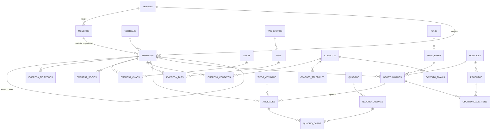

# CRM Alessandro — Modelagem do Banco de Dados

> Status: **Aprovado (v1.1)** · Data: 06/10/2026
> v1.1: revisão pelo protótipo: `membros.preferencias`; próxima atividade calculada em `empresas`; datas de controle de parada em `oportunidades`
> v1.0: modelagem fechada (consolida v0.1 a v0.3)
> v0.2: incluído o **complemento** do endereço na tabela `empresas`
> v0.3: **multiempresa**: conta dona de várias empresas (tenants), usuários com papel por empresa e painel consolidado
> Base: `configuracao_tecnologia.md` (v1.3) e `funcionalidades.md` (v1.4)
> Banco: PostgreSQL + PostGIS · Nomes em **português**, `snake_case`

---

## 0. Decisões desta etapa

| # | Decisão | Escolha |
|---|---|---|
| 1 | Vendedores | **Vendedor = membro da equipe (usuário)**. Pode existir sem login (ex.: representante externo) |
| 2 | Atividades × Tarefas | **Unificadas** numa única tabela `atividades` (tipo "Tarefa" incluído) |
| 3 | Oportunidade | **Status separado da Fase**: Ativo · Conquistado · Perdido · Cancelado · Suspenso |
| 4 | Solução | Tabela cadastrável `solucoes` (agrupa produtos) |
| 5 | Recorrência de produtos | Item com cobrança **Única / Mensal / Anual** + meses → Valor único, Valor mensal (MRR) e Valor total |
| 6 | Documento da empresa | **CNPJ, CPF ou sem documento**; CNPJ único por tenant |
| 7 | Matriz/filial | Vínculo automático pela **raiz do CNPJ** |
| 8 | Data de registro | Data de cadastro no CRM (`criado_em`) |
| 9 | Campos extras da Receita | Apenas o **complemento** do endereço (v0.2); os demais ficam só no JSON do cache de consultas |
| 10 | Atualização Receita | Botão "Atualizar pela Receita" (com comparação) + rotina mensal de verificação |
| 11 | Funcionários / Faturamento | **Faixas cadastráveis** (+ nº exato opcional de funcionários) |
| 12 | Prospecção | **Sim**: busca por CNAE + UF/município na API e importação como Lead |
| 13 | Vertical | **Uma por empresa**; substitui o grupo de tags "Segmento" |
| 14 | Situação da atividade | Pendente · Em execução · Realizada · **Cancelada** (Atrasada é calculada) |
| 15 | Contatos (extras) | Papel na decisão, aniversário, LinkedIn, consentimento LGPD |
| 16 | Multiempresa | **Conta dona** de várias empresas (tenants); dados **isolados** por empresa + **painel consolidado**; cópia de configurações entre empresas |
| 17 | Usuários em várias empresas | Mesmo login em várias empresas, com **papel definido em cada uma** |

---

## 1. Convenções

| Item | Padrão |
|---|---|
| Chave primária | `id uuid` (UUID v7, gerado na aplicação) |
| Multitenant | `tenant_id uuid NOT NULL` em toda tabela de negócio + **RLS** |
| Auditoria básica | `criado_em`, `atualizado_em` (`timestamptz`), `criado_por`, `atualizado_por` (→ `membros`) |
| Exclusão | **Soft delete**: `excluido_em timestamptz` (lixeira) |
| Datas e horas | `timestamptz` (gravado em UTC; exibido no fuso do tenant) |
| Dinheiro | `numeric(15,2)` (nunca `float`) |
| Textos de busca | `citext` para e-mails; índices `pg_trgm` + `unaccent` em nomes |
| Enumerações fixas | Tipos `ENUM` do Postgres (ex.: `situacao_atividade`) |
| Listas que o cliente edita | Tabelas cadastráveis (ex.: `origens`, `motivos`) |
| Campos personalizados | Coluna `campos_extras jsonb` (definições em `campos_personalizados`) |
| Unicidade com soft delete | Índices únicos **parciais** (`WHERE excluido_em IS NULL`) |
| Ordenação manual (Kanban) | Coluna `posicao` com índice fracionário (texto), sem renumerar a lista |

**Legenda das tabelas:**
🌐 global (sem tenant, compartilhada, somente leitura para a aplicação) · 🏢 por tenant (com RLS) · 🔮 fase futura

---

## 2. Visão geral (diagrama)



---

## 3. Plataforma e tenant

### 3.0 Estrutura multiempresa

```
CONTA (dono / grupo)  ── cobrança, criação de empresas, administradores da conta
  ├── EMPRESA A (tenant) ── carteira, equipe, funis, tags… (isolados por RLS)
  ├── EMPRESA B (tenant)
  └── EMPRESA C (tenant)

USUÁRIO (login único) ── MEMBRO na Empresa A (admin)
                      └─ MEMBRO na Empresa B (vendedor)
```

- **Isolamento total** de dados entre empresas. O que muda é o **acesso**: um login pode ter vínculo (membro) em várias empresas, com papel próprio em cada uma.
- **Seletor de empresa** no topo do app. A sessão guarda a **empresa ativa** (`auth.session.empresa_ativa_id`), e toda requisição roda com `app.tenant_id` = empresa ativa.
- **Painel consolidado** (somente leitura): para **administradores da conta** (`conta_administradores`, papel dono ou administrador), a requisição define `app.tenant_ids` = todas as empresas da conta, e as políticas RLS de **leitura** aceitam `tenant_id = ANY(app.tenant_ids)`. Gravações continuam exigindo uma única empresa ativa.
- **Copiar configurações** entre empresas da mesma conta: funis/fases, grupos de tags/tags, tipos de atividade, origens, motivos, soluções, produtos, faixas, verticais, campos personalizados e quadro modelo. É uma cópia (não um vínculo): depois cada empresa ajusta a sua.
- **Notificações** de todas as empresas aparecem na central, identificadas pela empresa (clicar troca a empresa ativa).

> **Descoberta de vínculos antes do tenant ativo (E8):** o guard da API precisa saber em quais empresas o usuário é membro *antes* de definir `app.tenant_id`, mas `membros` e `tenants` têm RLS forçado, que vale **também para o dono**. Sem papel `BYPASSRLS` e sem afrouxar o RLS do app, duas funções `SECURITY DEFINER` mínimas (do `leadtogo_owner`, `search_path` fixo, `EXECUTE` só para o `leadtogo_app`):
> - `app_vinculos_do_usuario(usuario_id)` → `(tenant_id, papel)` dos membros **ativos e não excluídos** do usuário. Só isso: o resto do membro se lê depois, com o tenant ativo, sob RLS.
> - `app_empresas_da_conta_do_usuario(usuario_id)` → `tenant_id` das empresas **em teste ou ativas** das contas em que o usuário é `dono` ou `administrador` (o `financeiro` não entra): é o `app.tenant_ids` do painel consolidado.
>
> - `app_vinculos_com_politica(usuario_id)` (migração 0011) → `(tenant_id, papel, dois_fatores_exigido)` dos mesmos vínculos, com a política de 2FA de cada empresa (`admin` se a empresa ainda não tem linha em `tenant_configuracoes`). É a que o guard da API usa; a `app_vinculos_do_usuario` fica até a contração (remover quando nada mais a usar). Política extra `FOR SELECT TO leadtogo_owner` em `tenant_configuracoes`, casada com a mesma variável `app.vinculos_usuario` e só para as empresas em que o usuário é membro ativo.
>
> Cada função define uma variável de transação (`app.vinculos_usuario` / `app.consolidado_usuario`) e a limpa ao terminar. Uma política `FOR SELECT TO leadtogo_owner` em `membros` e outra em `tenants` só casa com essa variável; como valem só para o papel `leadtogo_owner` (o app não é o owner, e o owner fora das funções não define a variável), nada muda para o app, para o owner direto nem para o isolamento entre empresas. Migração 0006.

### 3.0.1 `contas` 🌐 — Conta dona (cobrança e gestão)
| Coluna | Tipo | Observação |
|---|---|---|
| id | uuid PK | |
| nome | text NOT NULL | Ex.: "Grupo Alessandro" |
| documento | varchar(14) | CNPJ/CPF para faturamento |
| email_cobranca | citext | |
| plano | text | Plano contratado (limites de empresas/usuários) |
| situacao | enum | teste · ativa · suspensa · cancelada |
| criado_em, atualizado_em | timestamptz | |

### 3.0.2 `conta_administradores` 🌐
| Coluna | Tipo | Observação |
|---|---|---|
| conta_id | uuid FK | PK `(conta_id, usuario_id)` |
| usuario_id | uuid FK → `auth.user` | |
| papel | enum(dono/administrador/financeiro) | **Dono:** tudo, incluindo excluir a conta e transferir a posse · **Administrador:** cria empresas e tem acesso de admin em todas · **Financeiro:** só cobrança |
| criado_em | timestamptz | |

> Administradores da conta passam a ser **membros admin** de cada nova empresa automaticamente.
> Essas duas tabelas não têm RLS por tenant; o acesso é controlado pela API (somente usuários da própria conta).

### 3.1 `tenants` 🏢 — Cadastro da empresa que usa o sistema
Pode ser preenchido pela mesma consulta à Minha Receita.

| Coluna | Tipo | Observação |
|---|---|---|
| id | uuid PK | |
| razao_social | text NOT NULL | |
| nome_fantasia | text | |
| cnpj | varchar(14) | Alfanumérico (ver seção 12). **Sem unicidade global** (migração 0014): a restrição revelava a quem cadastra que outra conta usa o CNPJ. Índice `(conta_id, cnpj)` para avisar sobre repetição dentro da mesma conta |
| email, telefone, website | text | Contato institucional |
| cep, tipo_logradouro, logradouro, numero, complemento, bairro | text | |
| municipio_codigo | int FK → `municipios` | Cidade + UF |
| pais_codigo | smallint default 105 | Código do país na Receita (105 = Brasil) |
| logo_arquivo_id | uuid FK → `arquivos` | |
| conta_id | uuid FK → `contas` NOT NULL | Conta dona |
| situacao | enum `situacao_tenant` | teste · ativo · suspenso · cancelado |
| plano | text | Para cobrança futura (SaaS) |
| fuso_horario | text default 'America/Sao_Paulo' | |
| moeda | char(3) default 'BRL' | |
| criado_em, atualizado_em | timestamptz | |

### 3.2 `tenant_configuracoes` 🏢 (1:1 com tenant)
| Coluna | Tipo | Observação |
|---|---|---|
| tenant_id | uuid PK/FK | |
| vendedor_ve_todas_empresas | boolean default false | Regra de carteira |
| dias_sem_contato_alerta | int default 60 | Dashboard / filtros |
| dias_validade_tag_visita | int null | null = não expira |
| status_cliente_ao_conquistar | boolean default true | Ao conquistar, muda tag Status → Cliente |
| rastreio_email_padrao | boolean default false | 🔮 |
| whatsapp_modo_importacao | enum | 🔮 automático · manual · desligado |
| dois_fatores_exigido | enum `politica_dois_fatores` NOT NULL default `admin` | Quem é obrigado a ter 2FA nesta empresa: `admin` · `admin_gestor` · `todos` (migração 0011, de expansão; ver funcionalidades.md, "Segurança e acesso") |
| padroes_criados_em | timestamptz null | Quando os cadastros padrão (seção 5) foram criados. **Preenchido, nunca mais se recria**: um padrão que o administrador excluiu não volta (migração 0016, de expansão) |
| preferencias | jsonb | Demais ajustes |

> **Cadastros padrão por empresa (Módulo 1):** `criarPadroesDoTenant` (`packages/db/src/padroes.ts`) reserva a marca `padroes_criados_em` e cria tags (Status e Visitação), tipos de atividade, funil "Vendas" com 4 fases (alerta de parada de 14 dias), origens e motivos. Roda no primeiro acesso, ao criar empresa do grupo e no seed de demonstração. **Backfill:** a cada start da API (`iniciar.js`, depois do migrate e do seed de referências, com a credencial do dono) o passo `criarPadroesPendentesPorUrl` atende as empresas ainda sem a marca. Como o RLS forçado impede o dono de listar `tenants`, a migração 0016 criou `app_tenants_sem_padroes()` (`SECURITY DEFINER`, política só para o `leadtogo_owner`, travada numa variável que só a função define; devolve apenas ids, sem `EXECUTE` para o `leadtogo_app`). Falha numa empresa não derruba a API: fica o aviso no log e o próximo start tenta de novo.

### 3.3 Autenticação (Better Auth)
O Better Auth cuida só da **identidade**: `user`, `session`, `account`, `verification` e `two_factor`, num **schema separado `auth`**. O **plugin de organizações não é usado** (empresas, membros e convites são nossos, sob RLS). Ligações:
- `user.id` ↔ `membros.usuario_id` e `conta_administradores.usuario_id` (FK)
- `session.empresa_ativa_id` → `tenants.id` (`ON DELETE SET NULL`): a empresa ativa da sessão (campo nosso, adicionado à tabela do Better Auth). Ao criar a sessão a API a preenche (gancho `databaseHooks.session.create`): `user.ultima_empresa_id` se ainda utilizável, senão a única empresa utilizável, senão nulo
- `user.ultima_empresa_id` → `tenants.id` (`ON DELETE SET NULL`, migração 0012): a última empresa que a pessoa usou; gravada a cada troca de empresa ativa
- Tabelas em `auth`: `user` (e-mail em `citext`, único), `session`, `account` (senha em hash scrypt), `verification` e `two_factor`, todas com id `uuid` v7. Sem RLS (nada é por tenant); o `leadtogo_app` tem DML, sem DDL.

### 3.5 `convites` 🏢 — Convite de membro
| Coluna | Tipo | Observação |
|---|---|---|
| id | uuid PK | |
| tenant_id | uuid FK | |
| email | citext NOT NULL | Para quem foi enviado |
| papel | enum `papel_membro` | Papel que o convidado terá |
| token_hash | text NOT NULL UNIQUE | Hash (SHA-256) do token enviado por e-mail; o token em si **nunca** é gravado |
| expira_em | timestamptz | Validade de 7 dias |
| aceito_em | timestamptz null | Uso único |
| revogado_em | timestamptz null | Cancelado por um administrador antes de ser aceito |
| convidado_por | uuid FK → `membros` NOT NULL | |
| criado_em, atualizado_em | timestamptz | |

Único parcial `(tenant_id, email)` enquanto **pendente** (`aceito_em` e `revogado_em` nulos): reenviar um convite revoga o anterior e cria outro com token novo.

> **Aceite sem sessão (migração 0007):** quem aceita só tem o token, sem tenant ativo, e `convites` tem RLS forçado. Mesmo padrão da descoberta de vínculos (3.0): `app_convite_por_token(hash)`, `SECURITY DEFINER` do `leadtogo_owner`, `search_path` fixo, `EXECUTE` só para o `leadtogo_app`, devolve **só os ids** (`id`, `tenant_id`) e vale por uma política `FOR SELECT TO leadtogo_owner` travada na variável `app.convite_hash`, que só a função define e limpa. O resto (e-mail, papel, validade, situação) a API lê depois, com o tenant ativo e sob RLS.

---|---|---|
| id | uuid PK | |
| tenant_id | uuid FK | |
| email | citext NOT NULL | Para quem foi enviado |
| papel | enum `papel_membro` | Papel que o convidado terá |
| token_hash | text NOT NULL UNIQUE | Hash (SHA-256) do token enviado por e-mail; o token em si nunca é gravado |
| expira_em | timestamptz | Validade de 7 dias |
| aceito_em | timestamptz null | Uso único |
| convidado_por | uuid FK → `membros` | |
| criado_em, atualizado_em | timestamptz | |


### 3.4 `membros` 🏢 — Equipe / **Vendedores**
| Coluna | Tipo | Observação |
|---|---|---|
| id | uuid PK | |
| tenant_id | uuid FK | |
| usuario_id | uuid FK → `auth.user` **null** | null = vendedor **sem acesso** ao sistema |
| nome | text NOT NULL | |
| cargo | text | |
| telefone | varchar(20) | + `telefone_e164` |
| email | citext | |
| papel | enum `papel_membro` | admin · gestor · vendedor |
| gestor_id | uuid FK → `membros` | Hierarquia da equipe |
| cor | char(7) | Cor do vendedor em agenda/mapa |
| foto_arquivo_id | uuid FK | |
| ativo | boolean default true | Inativar mantém o histórico |
| preferencias | jsonb | Preferências de interface (v1.1), com **chaves fechadas**: `tema` (claro/escuro/sistema), `menuRecolhido`, `visaoDashboard` (minha/equipe) e `filtroPadrao` (id do filtro salvo por tela: empresas, contatos, oportunidades, tarefas). Só se guarda o que foge do padrão; `GET/PATCH /v1/me/preferencias` |
| criado_em, atualizado_em, excluido_em | | |

Únicos: `(tenant_id, email)` parcial; `(tenant_id, usuario_id)`.

O **mesmo usuário** (`usuario_id`) pode ter um registro em `membros` em **cada empresa**, com papel, cargo e gestor próprios naquela empresa (ex.: admin na A, vendedor na B).

> **Implementação (E7):**
> - `membros.usuario_id` e `conta_administradores.usuario_id` são FK para `auth.user` (migração 0005). Apagar um usuário deixa o membro sem login (`ON DELETE SET NULL`), mas é **recusado** se ele ainda administra uma conta (`RESTRICT`). As FKs de `tenants.logo_arquivo_id` e `membros.foto_arquivo_id` para `arquivos` entraram com as tabelas de sistema.
> - `membros` leva também `criado_por` e `atualizado_por` (→ `membros`), pela convenção da seção 1. O único `(tenant_id, usuario_id)` é parcial (`excluido_em IS NULL`), como o de e-mail.
> - `tenants` isola o RLS pela coluna `id` (`aplicar_rls_tenant('tenants', 'id')`). `contas` e `conta_administradores` não têm RLS (acesso controlado pela API); o app tem DML nelas.
> - `tenants.pais_codigo` é `smallint` com padrão `105` (Brasil, código da Receita) e não tem FK para `paises`. `tenant_configuracoes.whatsapp_modo_importacao` é um enum com padrão `desligado`.

---

## 4. Tabelas de referência 🌐 (globais)

| Tabela | Colunas principais | Origem |
|---|---|---|
| `cnaes` | **codigo int PK** (7 dígitos), descricao, secao, divisao, grupo, classe | Carga inicial com a lista oficial IBGE/CONCLA + inclusão automática se a API trouxer um código novo. **PK garante que não há duplicados** |
| `municipios` | **codigo_ibge int PK**, codigo_siafi int UNIQUE, nome, uf, localizacao (centro) | Carga IBGE. A API traz os dois códigos (`codigo_municipio` = SIAFI, `codigo_municipio_ibge`) |
| `estados` | uf char(2) PK, nome, regiao | |
| `paises` | **codigo smallint PK**, nome | Tabela de países da **Receita Federal** (dados abertos do CNPJ), com o código numérico dela (Brasil = 105). 255 códigos, incluindo territórios e códigos especiais (ex.: 997/999 "Não declarados") |
| `portes` | codigo smallint PK, descricao | 0 Não informado · 1 Micro Empresa · 3 Empresa de Pequeno Porte · 5 Demais |
| `qualificacoes_socio` | codigo smallint PK, descricao | Ex.: 49 Sócio-Administrador (cresce com a API) |
| `receita_consultas` | **cnpj PK**, dados jsonb, consultado_em, fonte | **Cache** do JSON completo de cada consulta (compartilhado: dado público). Evita consultas repetidas (validade 30 dias) e serve à rotina de verificação |

> O app só **lê** essas tabelas; a escrita fica com o *worker*. `receita_consultas` é a única que cresce com o uso.

> **Implementação (E7):** o `leadtogo_app` (API e worker usam o mesmo papel) tem só `SELECT` em `cnaes`, `municipios`, `estados`, `paises`, `portes` e `qualificacoes_socio`; a carga é do `leadtogo_owner` (seeds). Em `receita_consultas` ele tem `SELECT`, `INSERT` e `UPDATE` (sem `DELETE`). A inclusão automática de um CNAE novo, citada acima, ainda não tem permissão de escrita: quando a prospecção a implementar, entra por uma função `SECURITY DEFINER` mínima, não por `INSERT` direto. `municipios.localizacao` é `geometry(Point, 4326)`, nula até a carga dos centros. `municipios.codigo_siafi` é `UNIQUE`; a carga inicial traz todos preenchidos. A busca por nome usa `f_unaccent()` (invólucro imutável de `unaccent`) com índice trigram.

---

## 5. Cadastros auxiliares do tenant 🏢

Todas têm: `id`, `tenant_id`, `nome`, `ativo`, `ordem`, `criado_em`, `atualizado_em` e **único** `(tenant_id, lower(nome))`.

| Tabela | Colunas adicionais | Uso |
|---|---|---|
| `verticais` | cor | Empresa → 1 vertical |
| `faixas_funcionarios` | minimo int, maximo int | Ex.: 1–9, 10–49, 50–99, 100–499, 500+ |
| `faixas_faturamento` | minimo numeric, maximo numeric | Ex.: até 360 mil, até 4,8 mi, até 30 mi, acima |
| `tag_grupos` | selecao enum(unica/multipla), obrigatorio bool, sistema bool, automatico bool | Status, Visitação… |
| `tags` | tag_grupo_id FK, cor char(7), chave_sistema text null | `chave_sistema` identifica tags usadas pelas regras automáticas (ex.: `visitada`, `cliente`), mesmo que o cliente as renomeie |
| `tipos_atividade` | icone, cor, conta_como enum(visita/contato/nenhum), exige_empresa bool, sincroniza_agenda bool, chave_sistema | Ligação, WhatsApp, E-mail, Visita, Reunião, **Tarefa** |
| `funis` | padrao bool | |
| `funil_fases` | funil_id FK, cor, probabilidade_padrao smallint, dias_alerta_parada int | Só fases de **andamento** (o fechamento é pelo Status) |
| `origens` | — | Origem da oportunidade |
| `motivos` | aplica_a `status_oportunidade[]` | Ex.: "Preço" vale para Perdido; "Aguardando orçamento" para Suspenso |
| `solucoes` | cor, descricao | Linha de solução |
| `papeis_decisao` | — | Decisor, Influenciador, Usuário, Financeiro, Técnico |
| `etiquetas` | cor, dono_id null (null = da equipe) | Etiquetas de atividades/tarefas no Kanban |
| `campos_personalizados` | entidade enum(empresa/contato/oportunidade), chave, tipo enum, opcoes jsonb, obrigatorio, filtravel | Definição dos campos extras |

> **Implementação (Módulo 1, migração 0015):** criadas `verticais`, `solucoes`, `origens`, `motivos`, `tag_grupos`, `tags`, `tipos_atividade`, `funis` e `funil_fases` (as demais deste capítulo entram com o módulo que as usa; `faixas_*` ficam fora do MVP, ver `escopo_mvp.md`). Todas com `excluido_em`, `criado_por` e `atualizado_por`, RLS forçado e fábrica no teste de isolamento. Diferenças em relação à tabela acima:
> - **Cor** é o **nome da cor da paleta de tags** do design system (enum `cor_de_tag`: gray, red, orange, amber, green, teal, blue, indigo, purple, pink), não hexadecimal; assim a cor segue os tokens e o tema escuro. Vale para `verticais`, `solucoes`, `tags`, `tipos_atividade` e `funil_fases`.
> - **Nome único** (sem diferença de caixa, entre os não excluídos): por empresa, exceto `tags` (único **dentro do grupo**) e `funil_fases` (único **dentro do funil**).
> - `chave_sistema` (única por empresa, parcial) também existe em `tag_grupos` e `origens` (ex.: `importacao`), além de `tags` e `tipos_atividade`.
> - Enum `status_oportunidade` criado já aqui (`motivos.aplica_a`, com ao menos um valor); o Módulo 6 o reaproveita.
> - `funis`: no máximo **um padrão** por empresa (índice único parcial). `funil_fases`: `probabilidade_padrao` de 0 a 100 e `dias_alerta_parada` nulo (sem alerta) ou maior que zero.

### 5.1 `produtos` 🏢
| Coluna | Tipo | Observação |
|---|---|---|
| id, tenant_id | | |
| codigo | text | Único por tenant (parcial) |
| nome | text NOT NULL | |
| descricao | text | |
| tipo | enum(produto/servico) | |
| solucao_id | uuid FK → `solucoes` | |
| unidade | text | un, h, licença, mês… |
| preco_padrao | numeric(15,2) | |
| cobranca_padrao | enum `tipo_cobranca` | **unica · mensal · anual** |
| meses_padrao | smallint | Ex.: 12 (contrato padrão) |
| ativo | boolean | |

---

## 6. Empresas 🏢

### 6.1 `empresas`
| Coluna | Tipo | Campo pedido / observação |
|---|---|---|
| id, tenant_id | uuid | |
| tipo_documento | enum(cnpj/cpf/nenhum) | Cadastro manual sem CNPJ |
| documento | varchar(14) | **CNPJ** (ou CPF), só caracteres, sem máscara |
| cnpj_raiz | varchar(8) *gerada* | 8 primeiros caracteres; liga matriz e filiais |
| matriz_filial | enum(matriz/filial) | **Matriz ou Filial** |
| matriz_id | uuid FK → `empresas` | Preenchido automaticamente pela raiz |
| razao_social | text NOT NULL | **Razão Social** |
| nome_fantasia | text | **Nome Fantasia** (nome de exibição; se vazio, usa razão social) |
| mei | boolean default false | **MEI (Sim/Não)** |
| data_inicio_atividades | date | **Data Início Atividades** |
| porte_codigo | smallint FK → `portes` | **Porte** |
| regime_tributario | enum | **Regime Tributário**: MEI · Simples Nacional · Lucro Presumido · Lucro Real · Imune/Isenta · Não informado. Pré-preenchido pela API (MEI/Simples), editável |
| vendedor_id | uuid FK → `membros` | **Vendedor** (responsável pela carteira) |
| vertical_id | uuid FK → `verticais` | **Vertical** |
| website | text | **Website** |
| cep | char(8) | **CEP** |
| tipo_logradouro | text | **Endereço**: "RUA" |
| logradouro | text | "NELCY LOPES VIEIRA" |
| numero | text | "567" (texto: aceita "S/N", "KM 12") |
| complemento | text | Galpão, sala, bloco, andar (da Receita ou manual) |
| bairro | text | **Bairro** |
| municipio_codigo | int FK → `municipios` | **Cidade** + **Estado** (vêm do município) |
| pais_codigo | smallint default 105 | **País** (código da Receita; 105 = Brasil) |
| localizacao | geography(Point,4326) | **Geolocalização** (índice GiST) |
| geo_precisao | enum(exata/rua/cep/cidade) | Qualidade da coordenada |
| geo_origem | enum(google/nominatim/manual/checkin) | |
| geo_atualizado_em | timestamptz | |
| faixa_funcionarios_id | uuid FK | **Número de Funcionários** (faixa) |
| numero_funcionarios | int | Número exato (opcional) |
| faixa_faturamento_id | uuid FK | **Faixa de Faturamento** |
| observacoes | text | **Observações** |
| campos_extras | jsonb | Campos personalizados |
| origem_cadastro | enum | manual · receita · importacao · prospeccao · whatsapp · api |
| receita_atualizado_em | timestamptz | Última sincronização com a Receita |
| ultima_visita_em | timestamptz | Calculado (atividades) |
| ultimo_contato_em | timestamptz | Calculado (atividades) |
| proxima_atividade_id | uuid FK → `atividades` null | Calculado: próxima atividade pendente (v1.1) — lista, ficha e filtro "Sem próxima atividade" |
| proxima_atividade_em | timestamptz null | Data dela (v1.1) |
| criado_em | timestamptz | **Data de Registro** (cadastro no CRM) |
| atualizado_em, criado_por, atualizado_por, excluido_em | | |

**Endereço completo para exibição** = `tipo_logradouro + logradouro + ", " + numero + " – " + complemento` (o complemento só aparece se estiver preenchido). Os campos ficam **separados** no banco porque a geocodificação e a deduplicação ficam mais precisas.

**Status** e **Visitas** = **tags** (grupos "Status" e "Visitação"), em `empresa_tags`.

**Índices principais**
- Único parcial `(tenant_id, documento) WHERE documento IS NOT NULL AND excluido_em IS NULL`
- `(tenant_id, vendedor_id)`, `(tenant_id, municipio_codigo)`, `(tenant_id, vertical_id)`, `(tenant_id, cnpj_raiz)`
- GIN trigram em `razao_social` e `nome_fantasia` (busca por similaridade, sem acento)
- GiST em `localizacao`
- `(tenant_id, ultima_visita_em)`, `(tenant_id, ultimo_contato_em)`

### 6.2 `empresa_telefones` — **Telefone (mais de 1)**
| Coluna | Tipo | Observação |
|---|---|---|
| id, tenant_id, empresa_id | uuid | |
| numero | varchar(20) | Como digitado/recebido ("2730643021") |
| numero_e164 | varchar(16) | "+552730643021" (WhatsApp, busca, duplicados) |
| tipo | enum(fixo/celular/whatsapp/outro) | |
| descricao | text | Ex.: "Financeiro" |
| principal | boolean | |
| origem | enum(manual/receita/importacao) | |

Índice: `(tenant_id, numero_e164)`.

### 6.3 `empresa_cnaes` — **CNAE Principal e Secundários**
| Coluna | Tipo | Observação |
|---|---|---|
| tenant_id, empresa_id | uuid | PK composta `(empresa_id, cnae_codigo)` |
| cnae_codigo | int FK → `cnaes` | A descrição fica **só** na tabela `cnaes` |
| principal | boolean | Índice único parcial: **um** principal por empresa |

### 6.4 `empresa_socios` — **Sócios**
| Coluna | Tipo | Observação |
|---|---|---|
| id, tenant_id, empresa_id | uuid | |
| nome | text NOT NULL | **Nome** |
| qualificacao_codigo | smallint FK → `qualificacoes_socio` | **Qualificação** |
| contato_id | uuid FK → `contatos` null | Preenchido quando o sócio é **convertido em contato** (botão na ficha) |
| origem | enum(receita/manual) | |

> O CPF mascarado do sócio (`***501257**`) **não é gravado**, porque não serve para nada e é dado pessoal (LGPD).

### 6.5 `empresa_tags` — Status, Visitação e demais tags
| Coluna | Tipo | Observação |
|---|---|---|
| tenant_id, empresa_id, tag_id | uuid | PK `(empresa_id, tag_id)` |
| automatica | boolean | Aplicada por regra (ex.: Visitada) |
| aplicada_em, aplicada_por | | |

Regra (trigger ou serviço): em grupo de **seleção única**, a nova tag **substitui** a anterior.

### 6.6 `empresa_tags_historico`
`id, tenant_id, empresa_id, tag_id, acao (adicionada/removida), em, por, automatica`. Base para relatórios como "quantos Leads viraram Clientes no trimestre" e "tempo médio Lead → Cliente".

---

## 7. Contatos 🏢

### 7.1 `contatos`
| Coluna | Tipo | Observação |
|---|---|---|
| id, tenant_id | uuid | |
| nome | text NOT NULL | **Contato** |
| papel_decisao_id | uuid FK → `papeis_decisao` | Decisor, Influenciador… |
| aniversario_dia, aniversario_mes | smallint | Sem ano (menos dado pessoal) |
| linkedin_url | text | |
| aceita_whatsapp, aceita_email | boolean default true | **Consentimento / opt-out (LGPD)** |
| consentimento_em, consentimento_origem | timestamptz, text | Quando e como foi registrado |
| observacoes | text | **Observação** |
| campos_extras | jsonb | |
| criado_em, atualizado_em, excluido_em… | | |

### 7.2 `empresa_contatos` — vínculo N:N
| Coluna | Tipo | Observação |
|---|---|---|
| id, tenant_id, empresa_id, contato_id | uuid | Único `(empresa_id, contato_id)` |
| cargo | text | **Cargo** (por empresa) |
| principal | boolean | Contato principal da empresa |
| ativo | boolean | Saiu da empresa → inativo, mantendo o histórico |
| desde, ate | date | Opcional |

### 7.3 `contato_telefones` / `contato_emails` — **mais de 1**
- Telefones: mesma estrutura de `empresa_telefones` (+ `numero_e164`)
- E-mails: `id, tenant_id, contato_id, email citext, tipo (pessoal/trabalho), principal`, com índice `(tenant_id, email)` (duplicados e identificação de e-mails 🔮)

---

## 8. Atividades (unificadas com tarefas) 🏢

### 8.1 `atividades`
| Coluna | Tipo | Campo pedido / observação |
|---|---|---|
| id, tenant_id | uuid | |
| tipo_atividade_id | uuid FK | **Tipo**: Ligação · WhatsApp · E-mail · Visita · Reunião · Tarefa |
| titulo | text NOT NULL | Ex.: "Apresentar proposta" |
| empresa_id | uuid FK null | Obrigatória, **exceto** se o tipo tem `exige_empresa = false` (Tarefa) |
| oportunidade_id | uuid FK null | Opcional (da mesma empresa) |
| responsavel_id | uuid FK → `membros` | Quem executa |
| data_inicio | timestamptz | **Data** (e hora) — prazo, no caso de tarefa |
| data_fim | timestamptz null | Duração (reuniões/visitas) |
| dia_inteiro | boolean | |
| situacao | enum `situacao_atividade` | **Pendente · Em execução · Realizada · Cancelada** |
| realizada_em | timestamptz | Preenchido ao concluir |
| resultado | text | O que aconteceu |
| importante | boolean default false | **Importante** |
| urgente | boolean default false | **Urgente** (com Importante, forma a matriz de prioridade) |
| recorrencia_id | uuid FK null | **Recorrência** (série) |
| recorrencia_ocorrencia_em | timestamptz | Data original da ocorrência na série |
| observacoes | text | **Observações** |
| origem | enum | manual · whatsapp · email · agenda · api · recorrencia |
| id_externo | text | Thread de e-mail, evento de agenda, conversa WhatsApp (idempotência) |
| checkin_local, checkin_em | geography, timestamptz | 🔮 check-in de visita com GPS |
| criado_em, atualizado_em, excluido_em… | | |

- **Atrasada** = `situacao IN (pendente, em_execucao) AND data_inicio < agora()` (calculado, não gravado).
- **Índices:** `(tenant_id, responsavel_id, situacao, data_inicio)`, `(tenant_id, empresa_id, data_inicio DESC)`, `(tenant_id, oportunidade_id)`, único `(tenant_id, origem, id_externo)` parcial.

### 8.2 `atividade_lembretes` — **Notificar em**
`id, tenant_id, atividade_id, notificar_em timestamptz, canal enum(app/push/email/whatsapp), enviado_em`. Uma atividade pode ter vários lembretes (ex.: 1 dia antes e 30 min antes). O *worker* lê os pendentes e cria a notificação.

### 8.3 `atividade_recorrencias` — **Recorrência**
| Coluna | Tipo | Observação |
|---|---|---|
| id, tenant_id | uuid | |
| regra | text | Padrão **RRULE** (calendário), ex.: `FREQ=WEEKLY;BYDAY=FR` ou `FREQ=MONTHLY;BYMONTHDAY=5` |
| inicio | timestamptz | |
| termino_em / termino_ocorrencias | date / int | Até quando |
| modelo | jsonb | Dados copiados para cada nova ocorrência (tipo, título, empresa, responsável, lembretes) |
| ativa | boolean | |

Estratégia: o sistema gera as ocorrências **de 60 dias à frente** (rotina diária). Ao editar uma ocorrência, o usuário escolhe entre "só esta", "esta e as próximas" ou "todas". O formato RRULE é o mesmo do Google e do Outlook, o que facilita a sincronização 🔮.

### 8.4 Tabelas complementares
| Tabela | Colunas | Uso |
|---|---|---|
| `atividade_contatos` | atividade_id, contato_id | Participantes (vários contatos) |
| `atividade_checklist` | id, atividade_id, texto, concluido, ordem | Subitens da tarefa |
| `atividade_etiquetas` | atividade_id, etiqueta_id | Etiquetas coloridas |

### 8.5 Kanban de tarefas
| Tabela | Colunas | Observação |
|---|---|---|
| `quadros` | id, tenant_id, nome, tipo enum(modelo/pessoal/equipe), dono_id → membros, tipos_exibidos uuid[], ativo | O quadro **modelo** do admin é copiado para cada novo membro |
| `quadro_colunas` | id, quadro_id, nome, cor, ordem, limite_cards, situacao_vinculada enum null | Ex.: a coluna "Feito" vinculada a **Realizada**. Mover o card para ela conclui a atividade |
| `quadro_cards` | quadro_id, atividade_id, coluna_id, posicao | Único `(quadro_id, atividade_id)`. A mesma atividade pode estar no quadro pessoal e no de equipe |

---

## 9. Funil e oportunidades 🏢

### 9.1 `oportunidades`
| Coluna | Tipo | Campo pedido / observação |
|---|---|---|
| id, tenant_id | uuid | |
| titulo | text NOT NULL | Sugestão automática: "Empresa – Solução" |
| empresa_id | uuid FK NOT NULL | **Empresa (busca)** |
| contato_id | uuid FK null | **Contato** principal, só da empresa escolhida (validado pelo vínculo `empresa_contatos`) |
| solucao_id | uuid FK | **Solução** |
| origem_id | uuid FK | **Origem** (cadastrável) |
| funil_id, fase_id | uuid FK | **Fase** (de acordo com o funil) |
| status | enum `status_oportunidade` | **Ativo · Conquistado · Perdido · Cancelado · Suspenso** |
| motivo_id | uuid FK null | **Motivo** (cadastrável; obrigatório para Perdido/Cancelado/Suspenso) |
| motivo_detalhe | text | Complemento livre |
| suspensa_ate | date null | Suspenso → "retomar em", que cria uma atividade de follow-up automaticamente |
| responsavel_id | uuid FK → membros | Padrão: vendedor da empresa |
| valor_unico | numeric(15,2) | Soma dos itens de cobrança **única** |
| valor_mensal | numeric(15,2) | **MRR** = mensais + anuais ÷ 12 |
| valor_total | numeric(15,2) | Valor total do contrato |
| valor_manual | boolean | true = valores digitados (sem itens) |
| probabilidade | smallint | Sugerida pela fase |
| data_prevista_fechamento | date | |
| data_fechamento | timestamptz | Ao sair de "Ativo" |
| fase_desde | timestamptz | Quando entrou na fase atual (v1.1) — "Parada há N dias nesta fase" |
| ultima_atividade_em | timestamptz null | Última atividade realizada ligada à oportunidade (v1.1) — alerta de parada |
| proxima_atividade_id, proxima_atividade_em | uuid / timestamptz null | Próxima atividade pendente (v1.1) — card do Kanban e "Sem próxima atividade" |
| observacoes | text | **Observações** |
| campos_extras | jsonb | |
| criado_em, atualizado_em, excluido_em… | | |

**Regras**
- O Kanban mostra as oportunidades com status **Ativo**, nas colunas das fases. Ao fechar (Conquistado/Perdido/Cancelado), o card sai do quadro e a **fase em que parou fica gravada** (permite saber em qual fase mais se perde).
- **Suspenso** pode aparecer numa raia/filtro própria, e a oportunidade volta a Ativo com um clique.
- Conquistar dispara a automação "empresa vira Cliente" (se ligada).
- **Índices:** `(tenant_id, status, funil_id, fase_id)`, `(tenant_id, responsavel_id, status)`, `(tenant_id, empresa_id)`, `(tenant_id, data_prevista_fechamento)`.

### 9.2 `oportunidade_itens` — **Produtos e Serviços**
| Coluna | Tipo | Observação |
|---|---|---|
| id, tenant_id, oportunidade_id | uuid | |
| produto_id | uuid FK | Busca no catálogo |
| descricao | text | Cópia do nome (edita sem alterar o catálogo) |
| quantidade | numeric(12,3) | |
| preco_unitario | numeric(15,2) | Sugerido pelo catálogo, editável |
| desconto_percentual | numeric(5,2) | |
| cobranca | enum `tipo_cobranca` | **unica · mensal · anual** |
| meses | smallint null | **Quantidade de meses** (null em cobrança única) |
| valor_periodo | numeric(15,2) | qtd × preço × (1 − desconto): valor por mês, por ano ou único |
| valor_total | numeric(15,2) | única = valor_periodo · mensal = valor_periodo × meses · anual = valor_periodo × (meses ÷ 12) |
| ordem | smallint | |

**Exemplo:** Licença R$ 500/mês × 12 meses (total R$ 6.000) + Implantação R$ 2.000 (única) → **Valor único R$ 2.000 · Mensal R$ 500 · Total R$ 8.000**.

### 9.3 Tabelas complementares
| Tabela | Colunas | Uso |
|---|---|---|
| `oportunidade_contatos` | oportunidade_id, contato_id, papel | Outros contatos envolvidos |
| `oportunidade_historico` | id, oportunidade_id, fase_de, fase_para, status_de, status_para, motivo_id, em, por | Conversão, tempo médio por fase e auditoria do funil |

---

## 10. Prospecção (Minha Receita) 🏢

### 10.1 `prospeccoes` — buscas
| Coluna | Tipo | Observação |
|---|---|---|
| id, tenant_id | uuid | |
| nome | text | Ex.: "Usinagens — Serra/ES" |
| filtros | jsonb | `{cnae:[2539001], uf:["ES"], municipio:[3205002], natureza_juridica:[]}` |
| somente_ativas | boolean default true | Filtra pela situação cadastral do JSON |
| situacao | enum(processando/concluida/erro) | Busca paginada em segundo plano (cursor) |
| total_encontrado, total_importado | int | |
| criado_por, criado_em | | |

### 10.2 `prospeccao_resultados`
| Coluna | Tipo | Observação |
|---|---|---|
| id, prospeccao_id, tenant_id | uuid | |
| cnpj, razao_social, nome_fantasia, municipio_codigo, cnae_principal | | Resumo para a lista de revisão |
| situacao_cadastral | text | Apenas para filtrar a lista |
| empresa_id | uuid null | **Já existe no CRM?** Preenchido por comparação de CNPJ |
| selecionado | boolean | |
| importado_em | timestamptz | |

Fluxo: buscar → revisar a lista (as empresas que já estão no CRM aparecem marcadas) → escolher vendedor, vertical e tag (Lead) → importar. O JSON completo vai para `receita_consultas`, e as empresas são criadas com `origem_cadastro = prospeccao`.

---

## 11. Tabelas do sistema 🏢

| Tabela | Colunas principais | Uso |
|---|---|---|
| `arquivos` | id, tenant_id, chave_arquivo, nome, mime, tamanho, entidade_tipo, entidade_id, enviado_por | Anexos de qualquer entidade |
| `comentarios` | id, tenant_id, entidade_tipo, entidade_id, autor_id, texto, criado_em | Comentários em atividades e oportunidades |
| `notificacoes` | id, tenant_id, membro_id, tipo, titulo, mensagem, link, lida_em, criado_em | Central de notificações |
| `preferencias_notificacao` | membro_id, tipo_evento, canais text[] | Usuário escolhe o que recebe |
| `filtros_salvos` | id, tenant_id, membro_id, tela, nome, filtros jsonb, compartilhado | Filtros salvos |
| `importacoes` | id, tenant_id, tipo, arquivo_id, mapeamento jsonb, situacao, totais jsonb, erros jsonb | Importação de planilhas |
| `auditoria` | id bigint, tenant_id, entidade, entidade_id, acao, alteracoes jsonb (antes/depois), membro_id, origem (app/api/integracao/sistema), ip, em | Log de alterações (**particionado por mês**) |
| `eventos_outbox` | id, tenant_id, tipo, entidade_id, payload jsonb, criado_em, processado_em, falhou_em, tratado_em, tratado_por, tratamento (+ controle do relay, ver abaixo) | Fila de eventos (webhooks n8n, notificações) |

> **Implementação (E7) — `auditoria`:**
> - O `leadtogo_app` só tem **INSERT e SELECT** (log só de acréscimo); `UPDATE` e `DELETE` são negados por privilégio. A manutenção das partições é do `leadtogo_owner`.
> - Particionada por mês (`RANGE (em)`, UTC), PK `(id, em)`, `id` gerado pelo banco. Existem partições do mês anterior até 12 meses à frente e uma partição `auditoria_default` como rede de segurança. `criar_particao_auditoria(mes date)` (só o owner executa, idempotente) cria a do mês pedido; o worker não usa o owner: o job mensal chama `app_manter_particoes_auditoria(meses)` (E10, ver abaixo).
> - As políticas de RLS ficam na tabela-mãe. As partições têm RLS forçado **sem políticas** e o app não tem privilégio nelas: acesso direto a uma partição não lê nada.
> - `eventos_outbox` e `notificacoes` têm RLS e DML normais; `arquivos.chave_arquivo` é única.

> **Implementação (E10) — `eventos_outbox` e o relay do worker:**
> - O evento é gravado **na mesma transação** do dado de negócio (desfeita a transação, não há evento). `processado_em` significa "entregue à fila do worker" (ou, para eventos com efeito externo como o `convite.enviar`, "efeito concluído": o manipulador devolve uma função que o relay chama **depois do commit** e só então marca o evento); nesse momento o `payload` é apagado (o job do BullMQ o carrega). `falhou_em` marca o evento que **esgotou as tentativas** (nunca mais é reservado; o alerta da E14 olha esta coluna). Colunas de controle (migração 0008): `tentativas`, `proxima_tentativa_em` (espera progressiva), `reservado_ate` e `ultimo_erro`.
> - **Sem `BYPASSRLS`:** o worker conecta como `leadtogo_app` e não vê eventos de tenant nenhum sem tenant ativo. `app_reservar_eventos(limite, reserva_s)` (`SECURITY DEFINER` do `leadtogo_owner`, `search_path` fixo, `EXECUTE` só para o `leadtogo_app`, mesmo padrão de 3.0 e 3.5) reserva um lote de eventos pendentes e vencidos com `FOR UPDATE SKIP LOCKED` (dois relays nunca pegam o mesmo), soma 1 à tentativa e devolve **só `(id, tenant_id)`**; lote de 1 a 200 e reserva de 5 a 600 s. Duas políticas `TO leadtogo_owner` (SELECT e UPDATE), travadas na variável `app.outbox_reserva`, que só a função define e limpa. Tipo e payload o worker lê depois, com o tenant ativo, sob RLS.

> **Implementação (E14) — alerta e tratamento dos eventos esgotados (migração 0013):** ao esgotar as tentativas o evento **mantém o `payload`** (antes era apagado), para poder ser reprocessado; os payloads do outbox não carregam segredos (o token do convite nasce na hora do envio). Colunas novas, só de expansão: `tratado_em`, `tratado_por` e `tratamento` (`reprocessado` ou `descartado`). Três funções `SECURITY DEFINER` do `leadtogo_owner` (`search_path` fixo, `EXECUTE` só para o `leadtogo_app`, políticas `TO leadtogo_owner` travadas na variável `app.outbox_alertas`): `app_contar_eventos_esgotados()` (só o número, para o `GET /health/alertas`), `app_listar_eventos_esgotados(limite)` (sem o payload) e `app_tratar_evento_esgotado(id, acao, por)`. "Esgotado e pendente" = `falhou_em` preenchido e (`tratado_em` nulo ou anterior a `falhou_em`), então um evento reprocessado que esgota de novo volta a contar. O tratamento é feito pelo comando `node dist/outbox-tratar.js` (runbook_observabilidade.md), nunca por SQL manual. `--reprocessar` zera as tentativas e devolve o evento ao relay; `--descartar` apaga o payload.

> **Implementação (E10) — manutenção agendada (migração 0009), sem `BYPASSRLS`:** três funções `SECURITY DEFINER` do `leadtogo_owner` (`search_path` fixo, `EXECUTE` só para o `leadtogo_app`), com prazos fixos no corpo e lotes limitados (1 a 5000, padrão 500). Cada uma liga uma variável de transação que só ela define e limpa, e as políticas `TO leadtogo_owner` (SELECT/DELETE) dependem dela: o app, mesmo ligando a variável por conta própria, não lê nem apaga nada fora do tenant.
> - **Fuso e formato (migração 0010):** os limites das partições são sempre `00:00:00+00` literal, calculados em `timestamp` sem fuso e formatados com `to_char`; o "mês corrente" usa `now() AT TIME ZONE 'UTC'`. Nada depende do `TimeZone` nem do `DateStyle` da sessão (testado com UTC+14, UTC−12 e `SQL, DMY`).
> - `app_manter_particoes_auditoria(meses)`: garante a partição do mês corrente e as dos próximos `meses` (0 a 12) usando `criar_particao_auditoria`; devolve quantas criou; lock consultivo evita corrida.
> - `app_limpar_convites(lote)`: apaga convites **cancelados ou vencidos há mais de 30 dias** (os aceitos ficam, como histórico).
> - `app_limpar_outbox(lote)`: apaga eventos **entregues há mais de 14 dias**. Eventos com `falhou_em` nunca são apagados (o alerta da E14 depende deles).

### 11.1 Integrações 🔮 (estrutura prevista, criada nas fases 4–7)
| Tabela | Uso |
|---|---|
| `api_chaves` | Chaves de API por tenant (hash, escopos, validade) — n8n |
| `webhooks`, `webhook_entregas` | Destinos e log de entregas |
| `contas_conectadas` | Google/Microsoft/WhatsApp por membro (tokens **criptografados**) |
| `mensagens` | Mensagens de e-mail e WhatsApp ligadas a uma atividade (direção, remetente, corpo, id_externo) |
| `email_rastreios` | Aberturas e cliques |
| `modelos_mensagem` | Modelos de e-mail/WhatsApp |
| `conversas_nao_identificadas` | Números/e-mails desconhecidos |
| `territorios`, `rotas`, `rota_paradas` | Geolocalização e roteirização |
| `metas` | Metas por vendedor/período |
| `tenant_smtp` | SMTP próprio da empresa (futura; detalhe abaixo) |

#### `tenant_smtp` 🏢 (1:1 com tenant) 🔮 — futura, não implementar agora
SMTP que a empresa pode cadastrar em Configurações → E-mail (ver `funcionalidades.md`, seção 11). Sem linha (ou com `ativo = false`), os e-mails da empresa saem pelo SMTP da plataforma. Os e-mails de acesso (verificação, recuperação de senha, convites e 2FA) **nunca** usam esta tabela.

| Coluna | Tipo | Observação |
|---|---|---|
| tenant_id | uuid PK/FK | RLS habilitado e forçado, como toda tabela de negócio |
| servidor | varchar NOT NULL | Host do SMTP |
| porta | int NOT NULL | 1 a 65535 |
| seguranca | enum `seguranca_smtp` NOT NULL | `ssl` (implícito, ex.: 465) · `starttls` (587) · `nenhuma` |
| usuario | varchar null | Vai junto com a senha |
| senha_cifrada | text null | **AES-256-GCM com a `TOKEN_ENCRYPTION_KEY`**, com prefixo de versão da chave (`v1:`), como os e-mails da fila. Nunca em claro, nunca em logs nem na API |
| remetente_nome | varchar NOT NULL | |
| remetente_email | varchar NOT NULL | |
| ativo | boolean NOT NULL default false | Só pode ser `true` depois de um teste bem-sucedido |
| testado_em | timestamptz null | Último "Enviar teste" bem-sucedido |
| ultimo_erro | text null | Último erro de envio ou de teste (sem credenciais) |
| (padrão) | | `criado_em`, `atualizado_em`, `criado_por`, `atualizado_por` |

Trocar a `TOKEN_ENCRYPTION_KEY` exige recifrar `senha_cifrada` (por isso o prefixo de versão).

---

## 12. Pontos de atenção (o que ainda não tinha sido pensado)

1. **CNPJ alfanumérico (desde julho/2026).** A Receita passou a emitir CNPJs com **letras e números** nas 12 primeiras posições, mantendo os dígitos verificadores numéricos. Por isso:
   - `documento` é **texto** (`varchar(14)`), nunca número;
   - a validação usa o novo cálculo (valor ASCII − 48);
   - máscaras e importações não podem remover letras.
2. **Telefones da Receita** vêm como DDD + número ("2730643021", e às vezes vazios). Na importação: normalizar para E.164, descartar vazios, marcar `origem = receita` e tipo (celular se tiver 9 dígitos começando com 9).
3. **Dois códigos de município.** A API traz o SIAFI (`5699`) e o IBGE (`3205002`). O banco usa o **IBGE** (padrão do mapa e da geocodificação) e guarda o SIAFI na tabela `municipios` para a prospecção.
4. **Instabilidade da API pública.**
   - O cache em `receita_consultas` evita consultas repetidas.
   - Se a Minha Receita falhar, usar uma alternativa (ex.: BrasilAPI ou ReceitaWS) com o mesmo formato interno.
   - Hospedar a Minha Receita na VPS **não é viável** (a base completa ocupa centenas de GB).
5. **Rotina mensal e situação cadastral.** Como a situação cadastral não foi gravada na empresa, a rotina consulta a API, guarda o JSON no cache e **apenas notifica** quando a empresa estiver BAIXADA, INAPTA ou SUSPENSA (sem alterar o cadastro).
6. **Atualizar pela Receita sem apagar edições.** A tela mostra "valor atual × valor da Receita" campo a campo, e o usuário escolhe o que aplicar. Telefones e sócios são **somados** (não substituídos).
7. **Filiais e matriz.** Ao cadastrar uma filial cuja matriz já está no CRM, o vínculo é automático. Na ficha da matriz há a visão do **grupo econômico** (filiais, oportunidades e atividades somadas). Sugestão futura: herdar o vendedor da matriz.
8. **Sócio → contato.** Botão "Converter em contato": cria o contato com o nome, cargo = qualificação e vínculo com a empresa.
9. **"Retomar em" para oportunidades suspensas.** Sem data de retorno, uma oportunidade suspensa costuma ser esquecida. O campo `suspensa_ate` cria a atividade de retomada.
10. **Valores congelados.** Os itens guardam preço e descrição **copiados** do catálogo. Mudar o preço do produto não altera propostas antigas.
11. **Soft delete × unicidade.** Uma empresa excluída (na lixeira) não bloqueia o recadastro do mesmo CNPJ, graças ao índice único parcial. Restaurar a empresa verifica o conflito antes.
12. **LGPD.** Sócios sem CPF, aniversário sem ano, consentimento por canal e exclusão definitiva (anonimização) após o prazo da lixeira.
13. **RLS em tudo que é do tenant.** As tabelas 🌐 não têm `tenant_id` e são somente leitura para o usuário da aplicação. As tabelas filhas (ex.: `empresa_telefones`) também levam `tenant_id`, para que a política seja simples e rápida.
14. **Performance de listas.** Os campos `ultima_visita_em` e `ultimo_contato_em` ficam gravados na empresa e são atualizados pelo serviço de atividades, para que as listas e o mapa não precisem recalcular. O mesmo vale para `proxima_atividade_*` (empresas e oportunidades), `fase_desde` e `ultima_atividade_em`, mantidos pelo serviço de atividades e oportunidades (v1.1).

---

## 13. Resumo das tabelas

| Grupo | Tabelas | Qtd |
|---|---|---|
| Plataforma | contas, conta_administradores, tenants, tenant_configuracoes, membros, convites (+ tabelas do Better Auth) | 6 |
| Referência 🌐 | cnaes, municipios, estados, paises, portes, qualificacoes_socio, receita_consultas | 7 |
| Cadastros auxiliares | verticais, faixas_funcionarios, faixas_faturamento, tag_grupos, tags, tipos_atividade, funis, funil_fases, origens, motivos, solucoes, papeis_decisao, etiquetas, campos_personalizados, produtos | 15 |
| Empresas | empresas, empresa_telefones, empresa_cnaes, empresa_socios, empresa_tags, empresa_tags_historico | 6 |
| Contatos | contatos, empresa_contatos, contato_telefones, contato_emails | 4 |
| Atividades | atividades, atividade_lembretes, atividade_recorrencias, atividade_contatos, atividade_checklist, atividade_etiquetas, quadros, quadro_colunas, quadro_cards | 9 |
| Oportunidades | oportunidades, oportunidade_itens, oportunidade_contatos, oportunidade_historico | 4 |
| Prospecção | prospeccoes, prospeccao_resultados | 2 |
| Sistema | arquivos, comentarios, notificacoes, preferencias_notificacao, filtros_salvos, importacoes, auditoria, eventos_outbox | 8 |
| **Fase 1** | | **61** |
| Futuras 🔮 | api_chaves, webhooks, webhook_entregas, contas_conectadas, mensagens, email_rastreios, modelos_mensagem, conversas_nao_identificadas, territorios, rotas, rota_paradas, metas, tenant_smtp | 13 |

---

## 14. Próximos passos
1. ~~Validar esta modelagem~~ ✅ Aprovada em 05/10/2026. Novos ajustes entram como versões 1.x.
2. Gerar o **schema Drizzle** + migrações + **políticas RLS** + seeds (tags, tipos de atividade, funil padrão, CNAEs e municípios).
3. Montar o mapeamento **JSON Minha Receita → tabelas** (função de importação com testes usando o exemplo enviado).
